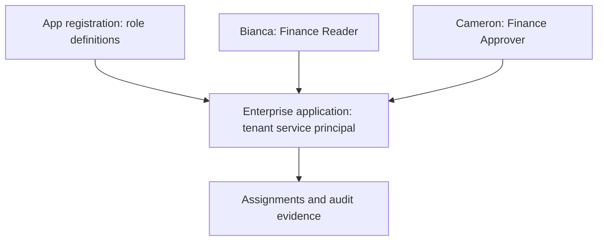

# Microsoft Entra ID: Enterprise Application Roles & Access Assignment

**Author:** [Farhan Muntasir](https://github.com/farhan115)  
**Completed:** November 16, 2026  
**Application:** `LAB-Northstar-Finance-RBAC`  
**Lab scope:** Application-role configuration, direct user assignments, assignment requirement, and audit review

## Overview

**Outcome:** Two business roles assigned to two test users, required assignment enabled, and six successful audit events reviewed.

Configured role-based access assignments for a fictional Finance application in Microsoft Entra ID. Defined business application roles, assigned two test users to different roles, required application assignment, and reviewed the audit trail.

This project demonstrates the identity configuration supporting application authorization. It does not claim to implement or test a working Finance application.

## Business scenario

Northstar needs to distinguish users who view Finance records from users who approve Finance requests. Its intended access model is:

| Business role | App-role value | Intended permissions enforced by application code |
|---|---|---|
| Finance Reader | `Finance.Reader` | View Finance records |
| Finance Approver | `Finance.Approver` | Review and approve Finance requests |

These roles apply to this application. They do not grant Microsoft Entra administrative privileges. The application would need code that checks the authenticated user's roles and enforces the intended actions. No role inheritance was implemented; Approver does not automatically include Reader.

## Verified results

| Item | Evidence |
|---|---|
| Finance Reader role | Enabled, allowed members Users/Groups, value `Finance.Reader` |
| Reader assignment | Bianca Pisani assigned Finance Reader |
| Approver assignment | Cameron White assigned Finance Approver |
| Assignment required | Yes, persisted with no pending changes shown |
| Enabled for users to sign in | Yes |
| Visible to users | No |
| Audit activity | Two successful app-role assignment grant events |
| Service-principal audit activity | One successful creation and three successful update events |

### Validation boundaries

- Role assignments and portal configuration were verified through screenshots.
- No redirect URI, running application, or end-to-end sign-in flow was configured for this exercise.
- Role claims in tokens were not inspected.
- Rejection of an unassigned user was not tested.
- Reader/Approver permissions were not enforced in application code.
- The inspected update event did not expose `AppRoleAssignmentRequired` in Modified Properties. The saved Properties page provided the configuration evidence instead.
- PKI, PIV, FIDO2, SCEP, ACME, and privileged-access workflows were outside this lab's scope.

## Resource relationships

**App registration:** Defines the application and its app roles.  
**Enterprise application:** Represents the application in the tenant and stores assignments and tenant-specific access settings.  
**App-role assignment:** Connects a principal, such as a user, to a role on the application's service principal.

## Prerequisites

- A Microsoft Entra lab tenant.
- Permission to register applications and manage the lab enterprise application's assignments and properties.
- Two existing lab test users.
- Access to relevant audit logs.

Direct user assignments were used. Group assignment behavior and licensing were not evaluated in this exercise.

## 1. Register the lab application

In the Microsoft Entra admin center:

1. Open **Entra ID → App registrations → New registration**.
2. Enter `LAB-Northstar-Finance-RBAC`.
3. Choose **Accounts in this organizational directory only**.
4. Leave Redirect URI blank for this configuration-only exercise.
5. Select **Register**.

**Explanation:** A single-tenant registration limits the intended identity audience to this organization. A redirect URI is needed when implementing an interactive sign-in flow; this lab stopped at configuration.

## 2. Define the business roles

Open the app registration's **App roles → Create app role**.

| Field | Reader | Approver |
|---|---|---|
| Display name | Finance Reader | Finance Approver |
| Allowed member types | Users/Groups | Users/Groups |
| Value | `Finance.Reader` | `Finance.Approver` |
| Description | Read-only access to Northstar Finance records | Review and approve Northstar Finance requests |
| Enable this app role | Checked | Checked |

Select **Apply** for each role.

**Explanation:** The display name identifies the role in assignment screens. The value is the string an integrated application can receive in a `roles` claim. A description documents intent but does not implement permissions.

## 3. Assign the Reader

1. Open **Entra ID → Enterprise applications**.
2. Find `LAB-Northstar-Finance-RBAC`.
3. Open **Users and groups → Add user/group**.
4. Select the lab user **Bianca Pisani**.
5. Select **Finance Reader** and choose **Assign**.

## 4. Assign the Approver

Repeat the assignment procedure using **Cameron White** and **Finance Approver**.

| Test user | Assigned role |
|---|---|
| Bianca Pisani | Finance Reader |
| Cameron White | Finance Approver |

**Explanation:** Different business responsibilities receive distinct role assignments. This configuration supports least-privilege design, but effective application permissions still depend on enforcement in the application.

## 5. Require assignment

In the enterprise application's **Properties**, configure:

| Setting | Value | Purpose |
|---|---|---|
| Enabled for users to sign in? | Yes | Keeps sign-in enabled for the enterprise application |
| Assignment required? | Yes | Configures assignment gating for ordinary user access |
| Visible to users? | No | Keeps the application tile hidden from My Apps |

Save, navigate away, and reopen Properties to verify persistence. The final screenshot showed the intended settings and a disabled Save button.

**Explanation:** Assignment requirement and My Apps visibility are separate controls. Hiding an application tile is not an access restriction. The requirement was configured here; sign-in enforcement was not tested. Administrator exceptions and application-flow behavior should be considered when designing an end-to-end test.

## 6. Review audit logs

1. Open the enterprise application's **Audit logs**.
2. Select **Last 24 hours**.
3. Review the activity, target, initiator, status, and available modified properties.

Observed successful activities:

| Activity | Count |
|---|---:|
| Add service principal | 1 |
| Update service principal | 3 |
| Add app role assignment grant | 2 |
| **Total** | **6** |

The two grant events confirm assignment activity, while the final Users and groups page identifies the actual user-to-role mappings.

## 7. Handle incomplete audit detail

The latest **Update service principal** event was opened. Its Modified Properties tab showed **Included Updated Properties** with an empty value. It did not show the specific assignment-required property.

**Resolution:** Verified the current setting directly on the saved Properties page. No extra configuration change was made just to generate a new event. The README does not attribute a specific property change to an event whose details did not establish it.

## Explanation and interview questions

### 1. What did you implement?

I configured two app roles, assigned separate test users, enabled assignment requirements, and verified configuration and successful audit activity for a dedicated enterprise application.

### 2. How are authentication and authorization different?

Authentication establishes identity. Authorization determines permitted actions. App roles support authorization when application code interprets and enforces them.

### 3. What is the difference between an app registration and enterprise application?

The registration defines the application, including roles. The enterprise application is the tenant's service principal, where local assignments and access settings are managed.

### 4. Why use business roles rather than making a user an Entra administrator?

Business application access should be scoped to the application. Entra directory administrator roles grant different management privileges and are unnecessary for viewing or approving Finance records.

### 5. What is the `roles` claim?

It contains applicable app-role values in a token issued for the relevant application or resource. This lab configured assignments but did not inspect a token. Roles for this app should not be expected in an unrelated Microsoft Graph token.

### 6. Does Finance Approver automatically include Finance Reader?

No. These are independent role definitions. Any inheritance or combined permissions must be explicitly designed and implemented.

### 7. Why assign two different users?

It makes the intended separation of business responsibilities visible and supports later positive and negative authorization tests.

### 8. Does Assignment required implement Reader/Approver authorization?

No. It configures an application-level assignment gate. The application must separately enforce the actions associated with each role.

### 9. Does hiding an app in My Apps prevent sign-in?

No. Visibility controls discovery through the tile. Assignment requirements, authentication policies, and application logic are separate controls.

### 10. What does least privilege mean here?

Assign users the minimum business role their responsibilities require, review access periodically, and remove unnecessary assignments. This lab demonstrates role separation, not a complete access-governance program.

### 11. What evidence supports the result?

The role definition, final user-to-role assignment table, saved application properties, and six successful audit events.

### 12. What would you test next?

A working OIDC application: verify role claims for each assigned user, deny an ordinary unassigned test user, and enforce Reader/Approver actions server-side with positive and negative tests.

## Troubleshooting questions and answers

### 1. Why is Finance Approver missing from Select a role?

Check that the role exists under the correct app registration, is enabled, and allows Users/Groups. Reopen the matching enterprise application's assignment dialog after saving. Confirm the application identity rather than relying only on similar display names.

### 2. Why can't I find Users and groups under App registrations?

User assignment is managed in **Enterprise applications**. App registrations is where the roles are defined.

### 3. Why does the application show a My Apps visibility warning?

Visible to users is No. This was intentional for a configuration-only lab. A visible tile does not supply a working sign-in flow or enforce permissions.

### 4. Why is the Save button disabled?

It commonly means there are no pending edits. In this run, the settings were reopened and still showed Assignment required Yes. A disabled button alone should not be treated as evidence of a specific setting value; inspect the value too.

### 5. Why did the audit list show grants without user-role details?

The list summarizes events. Open event details for targets and other fields, and compare with the current Users and groups page. Do not infer exact assignments from event counts alone.

### 6. Why was AppRoleAssignmentRequired absent from Modified Properties?

The selected event did not provide that property in the displayed details. It may not be the event containing the relevant change. Inspect other relevant events or available exported details, and verify the current state in Properties. This lab used saved configuration as its final evidence.

### 7. Why might a user still have access after assignment removal?

Existing tokens or application sessions may remain valid, and other direct or group-based assignments may still apply. Review all access paths and test with a fresh session. No removal/session-revocation test was performed here.

### 8. Why might a roles claim be missing after assignment?

Check the token audience, correct enterprise application and role assignment, role value, and whether the token was issued before the change. Obtain a fresh token for the intended application. Do not publish tokens or secrets in GitHub evidence.

### 9. Why can a Reader still approve requests in an application?

The application may not enforce role-based permissions, may map roles incorrectly, or may rely only on hidden UI elements. Authorization must be checked server-side for the protected action.

### 10. Why does an unassigned user still appear able to sign in?

Confirm assignment requirement on the correct service principal, existing app sessions, alternative assignments, the account's privileges, and the exact authentication flow. Use an ordinary unassigned test account and a fresh session. This behavior was not tested in today's lab.

### 11. What if the app does not launch from My Apps?

This exercise left the homepage/redirect configuration incomplete and visibility disabled. Implement the application and its supported sign-in configuration before treating launch behavior as a functional test.

### 12. What if I don't have permission to assign a role?

Check the signed-in account, tenant, and permissions for managing this application. Use an appropriately authorized lab administrator or delegated management role; do not grant broad directory privileges to the application users to solve an administration problem.

### 13. Can I disable a role to remove every assignment?

Do not assume disabling a role removes assignments or existing access. Review and remove the relevant assignments explicitly, then verify the current configuration and fresh application behavior.

### 14. Why do I see Default Access rather than the intended business role?

Inspect the actual assignment and role selection. Confirm the desired app role is available, then assign the intended role deliberately. A generic assignment is not evidence of Reader or Approver permissions.

## Acceptance checklist

- [x] Dedicated lab app created.
- [x] Finance Reader role definition observed.
- [x] Bianca assigned Finance Reader.
- [x] Cameron assigned Finance Approver.
- [x] Assignment required saved as Yes.
- [x] Sign-in enabled and My Apps visibility disabled.
- [x] Successful assignment and service-principal events reviewed.
- [x] Audit-detail limitation documented accurately.
- [ ] Token claims inspected — future extension.
- [ ] Unassigned-user rejection tested — future extension.
- [ ] Application permissions enforced and tested — future extension.

## Optional cleanup

After saving evidence, remove the two assignments if the lab should no longer retain them. Delete the dedicated lab registration and associated enterprise application only when no further testing depends on them. Verify the remaining objects; do not delete similarly named applications by mistake.

Cleanup was not performed in the recorded exercise.

## References

- [Add app roles and receive them in tokens](https://learn.microsoft.com/en-us/entra/identity-platform/howto-add-app-roles-in-apps)
- [Restrict an application to assigned users](https://learn.microsoft.com/en-us/entra/identity-platform/howto-restrict-your-app-to-a-set-of-users)

## Portfolio summary

Configured two business application roles in Microsoft Entra ID, assigned two test users to separate Reader and Approver roles, enabled required assignment, and reviewed six successful audit events. Verified configuration through portal evidence and documented remaining end-to-end authorization tests.
