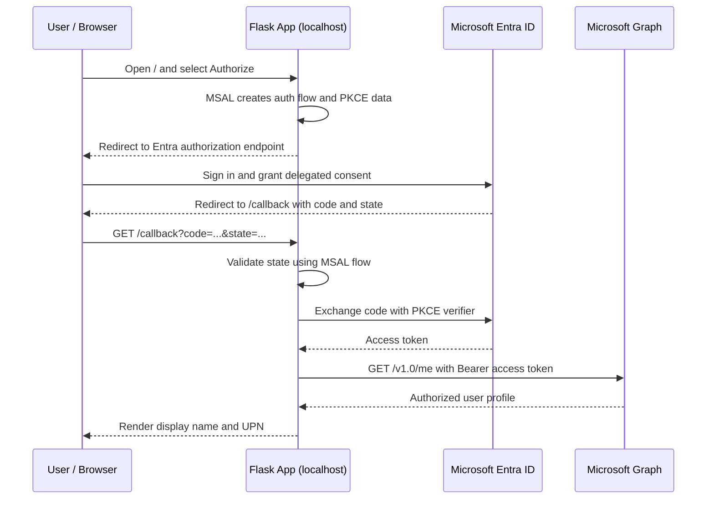

# Enterprise IAM Integration Lab 02 — OAuth 2.0 Authorization Code Flow with PKCE and Microsoft Graph

  

## Overview

This hands-on Identity and Access Management (IAM) lab demonstrates delegated API authorization using **Microsoft Entra ID**, **OAuth 2.0 Authorization Code Flow with PKCE**, **Microsoft Authentication Library (MSAL) for Python**, and **Microsoft Graph**.

A locally hosted Flask application redirects a user to Microsoft Entra ID for sign-in and consent, processes the authorization response, exchanges the authorization code for an access token, and uses that token to call `GET https://graph.microsoft.com/v1.0/me`.

**Lab result:** The application successfully displayed the signed-in user's display name and user principal name returned by Microsoft Graph.

> **Scope:** Educational localhost lab, not a production-ready web application. OAuth 2.0 provides delegated authorization; OpenID Connect (OIDC) should be used when an application needs a standardized authentication protocol and identity claims.

## Learning objectives

- Register a single-tenant application in Microsoft Entra ID.
- Configure a public-client redirect URI and delegated Microsoft Graph permissions.
- Explain authorization codes, access tokens, consent, OAuth state, and PKCE.
- Implement an OAuth authorization flow with MSAL for Python.
- Use server-side Flask sessions to hold temporary authorization-flow data.
- Call Microsoft Graph with a delegated access token.
- Verify successful authorization and troubleshoot common configuration errors.

## Architecture and flow



## Technology stack

| Component | Technology | Purpose |
| --- | --- | --- |
| Identity platform | Microsoft Entra ID | User sign-in, consent, token issuance |
| Authorization | OAuth 2.0 Authorization Code Flow | Delegated access to protected API |
| Authorization code protection | PKCE (S256) | Binds code redemption to original client flow |
| Python authentication SDK | MSAL for Python | Builds and processes authorization flow |
| Web application | Flask | Hosts local routes and callback |
| Session storage | Flask-Session | Stores temporary flow data server-side |
| API client | requests | Sends authorized HTTP requests |
| Protected API | Microsoft Graph `/v1.0/me` | Returns signed-in user profile |
| Configuration | python-dotenv | Loads local `.env` settings |

## Microsoft Entra application configuration

| Setting | Lab value |
| --- | --- |
| Application name | `Enterprise-IAM-OAuth-Lab02` |
| Supported account types | Single tenant |
| Redirect platform | Mobile and desktop applications (public client) |
| Redirect URI | `http://localhost:5000/callback` |
| Microsoft Graph API permission | `User.Read` — Delegated |
| Client secret | Not used in this public-client lab |

**Portal navigation:** Microsoft Entra admin center → **Entra ID** → **App registrations** → **Enterprise-IAM-OAuth-Lab02** → **Authentication** / **API permissions**.

> The redirect URI must match exactly between the Entra app registration and `.env`. Do not register the same redirect URI under multiple platform types. A production server-side Flask app should generally use an appropriately secured confidential-client architecture.

## Project layout

```text
Enterprise-IAM-OAuth-Lab02/
├── app.py               # Flask app and OAuth flow
├── .env                 # Local secrets/configuration — NEVER COMMIT
├── .gitignore           # Excludes local/private files
├── README.md            # Lab documentation
├── .venv/               # Python virtual environment — excluded
├── .flask_session/      # Local server-side session data — excluded
└── __pycache__/         # Python bytecode — excluded
```

## Windows CMD setup commands

### 1. Create and activate the project environment

```cmd
cd /d C:\Users\FOXTEC\Documents
mkdir Enterprise-IAM-OAuth-Lab02
cd Enterprise-IAM-OAuth-Lab02
python -m venv .venv
.venv\Scripts\activate
```

### 2. Install dependencies

```cmd
python -m pip install Flask msal python-dotenv requests Flask-Session
python -m pip show Flask msal python-dotenv requests Flask-Session
```

**Verified during this lab:** MSAL `1.39.0` and Flask-Session `0.8.0`. Other package versions depend on the local environment.

### 3. Create local configuration

```cmd
notepad .env
```

Example `.env` (replace placeholders; never commit real secrets):

```dotenv
CLIENT_ID=YOUR_APPLICATION_CLIENT_ID
TENANT_ID=YOUR_DIRECTORY_TENANT_ID
REDIRECT_URI=http://localhost:5000/callback
SCOPES=User.Read
FLASK_SECRET_KEY=YOUR_NEW_RANDOM_SECRET
```

Generate a new Flask secret:

```cmd
python -c "import secrets; print(secrets.token_hex(32))"
```

Copy the generated value **into `.env`**, not directly into Command Prompt. Keep it private and rotate any secret accidentally shown in screenshots or shared publicly.

### 4. Protect local files

Create `.gitignore`:

```cmd
notepad .gitignore
```

```gitignore
.env
.venv/
.flask_session/
__pycache__/
*.pyc
```

### 5. Validate application and sessions

```cmd
python -m py_compile app.py
python -c "import app; print('Session type:', app.app.config['SESSION_TYPE']); print('Session interface:', type(app.app.session_interface).__name__)"
```

Expected session output:

```text
Session type: filesystem
Session interface: FileSystemSessionInterface
```

### 6. Start Flask

```cmd
python app.py
```

Open `http://localhost:5000` in a browser. This lab uses localhost HTTP for development only.

## Flask routes

| Route | Method | Function |
| --- | --- | --- |
| `/` | GET | Show application homepage |
| `/login` | GET | Initialize MSAL authorization code flow and redirect to Entra ID |
| `/callback` | GET | Validate response, redeem authorization code, call Graph, display profile |

## Key implementation concepts

### Initiate the authorization flow

```python
flow = build_msal_app().initiate_auth_code_flow(
    scopes=["User.Read"],
    redirect_uri=REDIRECT_URI,
)
session["auth_flow"] = flow
return redirect(flow["auth_uri"])
```

MSAL prepares the authorization request and manages the flow state and PKCE-related material. Flask-Session stores the flow server-side for later validation.

### Process the callback

```python
flow = session.pop("auth_flow", None)
result = build_msal_app().acquire_token_by_auth_code_flow(
    flow,
    request.args.to_dict(),
)
```

The application validates the response against the original flow and exchanges the authorization code. Real implementations must handle missing flows, state mismatches, and token errors explicitly.

### Request the Microsoft Graph profile

```python
response = requests.get(
    "https://graph.microsoft.com/v1.0/me",
    headers={"Authorization": f"Bearer {result['access_token']}"},
    timeout=15,
)
```

The access token is sent to Microsoft Graph in an HTTP `Authorization: Bearer` header. The token must not be printed in logs, screenshots, or the README.

## Test procedure and verified results

1. Started Flask locally and opened the homepage.
2. Selected **Authorize with Microsoft Entra ID**.
3. Signed in with a lab-tenant account.
4. Reviewed the consent screen for the app's requested delegated permissions.
5. Accepted consent for the test user without granting organization-wide consent.
6. Returned to `/callback` after Microsoft Entra ID issued an authorization code.
7. MSAL completed the authorization code exchange.
8. Flask called Microsoft Graph `/v1.0/me` using the access token.
9. The application displayed **OAuth 2.0 Authorization Successful**, the user's display name and user principal name, and **Microsoft Graph: API request successful**.

**Observed outcome:** End-to-end delegated API authorization succeeded. The screenshots support successful token acquisition and Graph API access; they do not independently capture every underlying PKCE protocol message.

### Suggested screenshots for GitHub

Store redacted screenshots in an optional `screenshots/` directory:

- `01-entra-app-registration.png`
- `02-graph-user-read-permission.png`
- `03-public-client-redirect-uri.png`
- `04-flask-homepage.png`
- `05-entra-consent-screen.png`
- `06-oauth-graph-success.png`

**Before uploading:** Remove or obscure account identifiers if desired, and always remove authorization codes, access tokens, session cookies, and secret keys.

## Troubleshooting

| Symptom | Likely cause | Suggested check |
| --- | --- | --- |
| `SyntaxError: '(' was never closed` | Incomplete import or pasted code | Replace `app.py` with the complete file; run `python -m py_compile app.py` |
| `NameError: name 'app' is not defined` | Route decorator appears before Flask initialization | Ensure `app = Flask(__name__)` appears before all `@app.route` declarations |
| `FLASK_SECRET_KEY is not recognized` in CMD | `.env` assignment typed as a shell command | Put `FLASK_SECRET_KEY=...` inside `.env` |
| Redirect URI must have distinct values | Same URI registered on multiple platform types | Keep URI on the intended public-client platform only |
| Redirect URI mismatch | App registration and `.env` disagree | Compare exact URI, port, scheme, path, and platform |
| Missing OAuth authorization flow | Session lost or callback visited directly | Start from `/login`; check Flask-Session configuration and cookies |
| OAuth state validation failed | Unexpected/mismatched callback state | Restart authorization; do not bypass state validation |
| Token exchange failed | Client/platform mismatch or invalid authorization response | Inspect safe error codes and app registration settings; do not log tokens |
| Microsoft Graph request failed | Missing consent, incorrect scopes, invalid token, or connectivity | Check `User.Read` delegated permission and HTTP status |

## Security considerations

- Use **least-privilege delegated permissions**; this lab requests `User.Read`.
- Keep `.env`, local session files, and virtual environments out of version control.
- Rotate any secret exposed in terminal screenshots.
- Keep OAuth state validation enabled and use PKCE to protect code redemption.
- Do not log or publish authorization codes, access tokens, refresh tokens, or session cookies.
- Use HTTPS and secure session cookies in production.
- Use a confidential-client pattern for a production server-side web application where appropriate.
- Add secure session lifecycle handling, token cache controls, error monitoring, and proper logout for a production implementation.
- OAuth access tokens authorize API requests; use OIDC when you need standardized identity authentication and ID token validation.

## IAM engineering skills demonstrated

- Microsoft Entra ID application onboarding
- OAuth 2.0 Authorization Code Flow and PKCE fundamentals
- Public-client redirect URI configuration
- Delegated API permissions and user consent
- MSAL for Python integration
- Server-side session handling and OAuth state validation
- Microsoft Graph REST API access
- Authentication and authorization troubleshooting
- Security-conscious documentation and evidence collection

## Next lab

**Enterprise IAM Integration Lab 03 — OpenID Connect (OIDC) Authentication with Microsoft Entra ID**

Planned topics: ID tokens, claims, scopes (`openid`, `profile`, `email`), OIDC discovery metadata, nonce validation, authenticated user sessions, and differences between ID and access tokens.

---

**Lab status:** Completed and verified through successful Microsoft Graph profile retrieval.
