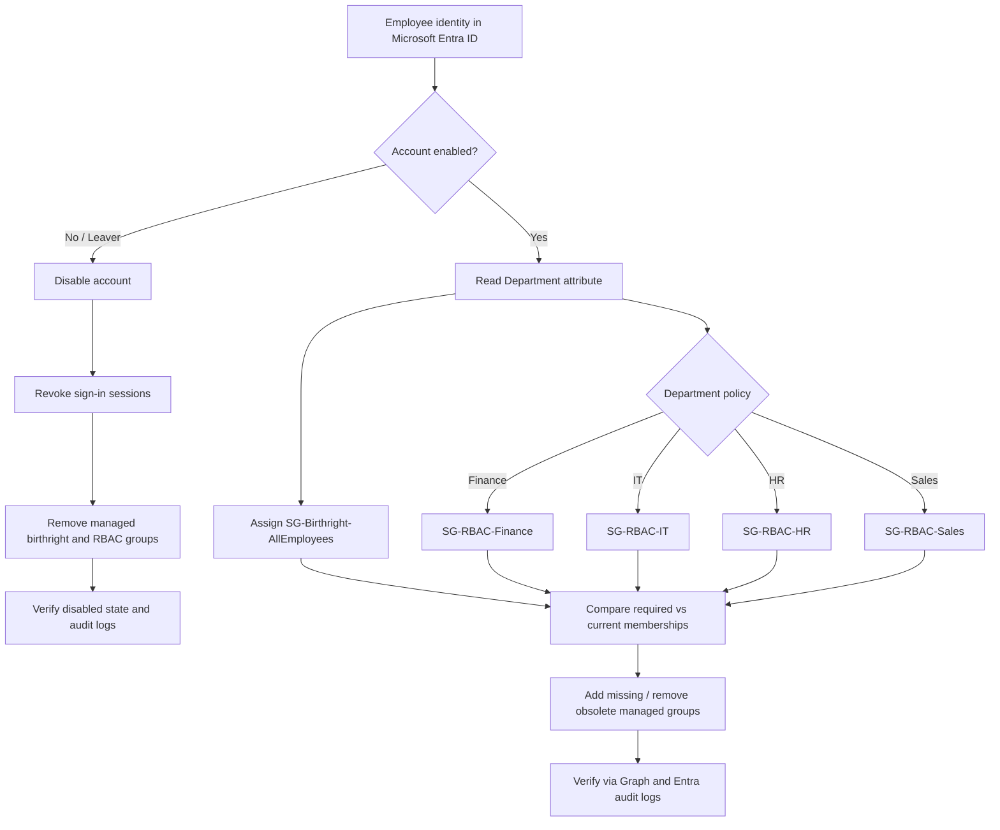

# Enterprise IAM Lab: RBAC, Birthright Access & Joiner–Mover–Leaver Workflows

**Platform:** Microsoft Entra ID · **Automation:** Microsoft Graph PowerShell · **Scenario:** Contoso Technologies (fictional organization)  
**Lab tenant:** Farhan Muntasir IT Labs · **Execution:** November 2–3, 2026 · **Status:** Completed and verified  
**Author:** Farhan Muntasir · **Focus:** Identity and Access Management (IAM), RBAC, provisioning, deprovisioning, auditing

> **Scope and accuracy:** This lab used administrator-executed PowerShell scripts and Entra ID portal actions. The scripts automated policy evaluation and group membership operations, but **no unattended HR integration, scheduled execution, or production access-control enforcement was implemented**. The security groups represent entitlements; this lab did not establish that each group granted access to a particular downstream application.

## Executive summary

Designed a five-group security model with baseline (birthright) access and department-specific RBAC for IT, Finance, HR, and Sales. Tested a single employee, **Sarah Mitchell**, through the Joiner, Mover, and Leaver lifecycle. Microsoft Graph PowerShell calculated and applied group changes, disabled the user at departure, revoked sign-in sessions, and verified directory audit activity. The final audit query returned **14 events, all 14 marked `success`**.

| Verified outcome | Result |
|---|---|
| Joiner | Sarah created; baseline + Finance groups assigned |
| Mover | Department changed Finance → IT; Finance group removed, IT group added, baseline retained |
| Leaver | Account disabled; sign-in sessions revoked; baseline + IT groups removed |
| Final user state | `AccountEnabled = False` |
| Final membership query | No directory-object memberships returned |
| Audit events | **14 total / 14 successful (100%)** |

## Architecture and access flow

This Mermaid diagram is **embedded directly in this README**; GitHub renders it without external images or broken image URLs.



### Access policy

| Identity condition | Managed group | Purpose |
|---|---|---|
| Enabled employee | `SG-Birthright-AllEmployees` | Baseline employee entitlement |
| `Department = IT` | `SG-RBAC-IT` | IT-specific entitlement |
| `Department = Finance` | `SG-RBAC-Finance` | Finance-specific entitlement |
| `Department = HR` | `SG-RBAC-HR` | HR-specific entitlement |
| `Department = Sales` | `SG-RBAC-Sales` | Sales-specific entitlement |
| Disabled / leaver | None of the above | Remove managed entitlements |

**Design note:** These were **assigned-membership** security groups. Department logic was implemented in PowerShell, **not** via Entra dynamic membership rules. The department attribute served as an input to an RBAC policy; this is not the same as granting Entra administrative roles.

## Lab environment

- Microsoft Entra admin center: <https://entra.microsoft.com>
- Windows PowerShell with Microsoft Graph PowerShell SDK
- Microsoft Graph delegated scopes used during the lab: `User.Read.All`, `Group.ReadWrite.All`, `User.EnableDisableAccount.All`, `User.RevokeSessions.All`, `AuditLog.Read.All`
- Admin account in **Farhan Muntasir IT Labs**; previously verified as holding the Global Administrator role
- Test employee: `sarah.mitchell@FarhanMuntasirITLabs.onmicrosoft.com`
- Test employee object ID: `4998fac6-4dbd-47a6-bf13-e9fb9ddc0b18`
- Employee ID: `RBAC-1001`; company: `Contoso Technologies`

> **Security:** Object IDs and fictional lab user identifiers are shown to make the procedure reproducible. Never publish access tokens, passwords, client secrets, recovery codes, or sensitive real employee data.

## 1. Joiner — Birthright and department provisioning

### 1.1 Create the group model

In **Entra ID → Groups → All groups → New group**, create five **Security** groups with **Membership type = Assigned**:

```text
SG-Birthright-AllEmployees
SG-RBAC-IT
SG-RBAC-Finance
SG-RBAC-HR
SG-RBAC-Sales
```

Keep **Microsoft Entra roles can be assigned to the group** disabled: these groups model business entitlements, not privileged directory role assignments. In production, assign owners and connect groups to approved resources/applications.

### 1.2 Create the employee

In **Entra ID → Users → All users → New user**, create Sarah Mitchell. Set job information:

```text
Display name: Sarah Mitchell
User principal name: sarah.mitchell@FarhanMuntasirITLabs.onmicrosoft.com
Company: Contoso Technologies
Department: Finance
Job title: Financial Analyst
Employee ID: RBAC-1001
Account enabled: True
```

### 1.3 Authenticate Microsoft Graph PowerShell

Run in **PowerShell** (`PS ...>`), not Command Prompt (`C:\...>`):

```powershell
Import-Module Microsoft.Graph.Authentication
Connect-MgGraph -TenantId "FarhanMuntasirITLabs.onmicrosoft.com" `
  -Scopes "User.Read.All","Group.ReadWrite.All"
Get-MgContext | Format-List Account,TenantId,Scopes
```

Use interactive sign-in and complete MFA. The actual tenant ID observed during the lab was `b40f8886-8c7b-4fe3-a273-b49505cb5998`.

### 1.4 Evaluate the birthright/RBAC policy (read-only)

```powershell
$UserUPN = "sarah.mitchell@FarhanMuntasirITLabs.onmicrosoft.com"
$User = Get-MgUser -UserId $UserUPN `
  -Property "Id,DisplayName,Department,AccountEnabled" -ErrorAction Stop

$GroupPolicy = @{
  IT      = "SG-RBAC-IT"
  Finance = "SG-RBAC-Finance"
  HR      = "SG-RBAC-HR"
  Sales   = "SG-RBAC-Sales"
}

$RequiredGroups = @()
if ($User.AccountEnabled -eq $true) {
  $RequiredGroups += "SG-Birthright-AllEmployees"
  if ($GroupPolicy.ContainsKey($User.Department)) {
    $RequiredGroups += $GroupPolicy[$User.Department]
  }
}

Write-Host "Employee: $($User.DisplayName)"
Write-Host "Department: $($User.Department)"
Write-Host "Account enabled: $($User.AccountEnabled)"
$RequiredGroups
```

**Observed policy decision:** Sarah Mitchell / Finance / enabled → `SG-Birthright-AllEmployees`, `SG-RBAC-Finance`.

### 1.5 Apply missing group assignments

The following is the same provisioning pattern used in the lab, with `$RequiredGroups` taken from the preceding policy evaluation. It checks existing membership before adding users.

```powershell
foreach ($GroupName in $RequiredGroups) {
  $Escaped = $GroupName.Replace("'", "''")
  $Matches = @(Get-MgGroup -Filter "displayName eq '$Escaped'" -ErrorAction Stop)
  if ($Matches.Count -ne 1) { throw "Expected one group: $GroupName" }
  $Group = $Matches[0]
  $Existing = @(Get-MgGroupMember -GroupId $Group.Id -All -ErrorAction Stop)

  if ($Existing.Id -contains $User.Id) {
    Write-Host "Already assigned: $GroupName"
  } else {
    New-MgGroupMemberByRef -GroupId $Group.Id -BodyParameter @{
      '@odata.id' = "https://graph.microsoft.com/v1.0/directoryObjects/$($User.Id)"
    } -ErrorAction Stop
    Write-Host "Successfully assigned: $GroupName"
  }
}
```

**Observed:** Both groups were added. Entra ID **Sarah Mitchell → Groups** independently displayed exactly `SG-Birthright-AllEmployees` and `SG-RBAC-Finance`.

## 2. Mover — Finance to IT

### 2.1 Update identity attributes

In **Entra ID → Users → Sarah Mitchell → Edit properties → Job Information**, update:

```text
Department: IT
Job title: IT Support Specialist
```

The portal change was manually saved. A Graph read confirmed the updated attributes:

```powershell
Get-MgUser -UserId $UserUPN `
  -Property "DisplayName,Department,JobTitle,AccountEnabled" |
  Select-Object DisplayName,Department,JobTitle,AccountEnabled
```

**Observed:** Sarah Mitchell / IT / IT Support Specialist / enabled.

### 2.2 Reconcile managed memberships (preview, no changes)

```powershell
$User = Get-MgUser -UserId $UserUPN `
  -Property "Id,DisplayName,Department,AccountEnabled" -ErrorAction Stop

$DepartmentGroups = @{
  IT = "SG-RBAC-IT"; Finance = "SG-RBAC-Finance"
  HR = "SG-RBAC-HR"; Sales = "SG-RBAC-Sales"
}
$ManagedGroupNames = @("SG-Birthright-AllEmployees") + @($DepartmentGroups.Values)

if ($User.AccountEnabled -ne $true) { throw "User is disabled; stop mover workflow" }
if (-not $DepartmentGroups.ContainsKey($User.Department)) {
  throw "Unrecognized department; manual review required"
}

$RequiredGroups = @("SG-Birthright-AllEmployees", $DepartmentGroups[$User.Department])
$CurrentGroups = @()

foreach ($GroupName in $ManagedGroupNames) {
  $Matches = @(Get-MgGroup -Filter "displayName eq '$GroupName'" -ErrorAction Stop)
  if ($Matches.Count -ne 1) { throw "Missing or duplicate group: $GroupName" }
  $Members = @(Get-MgGroupMember -GroupId $Matches[0].Id -All -ErrorAction Stop)
  if ($Members.Id -contains $User.Id) { $CurrentGroups += $GroupName }
}

$ToAdd    = @($RequiredGroups | Where-Object { $_ -notin $CurrentGroups })
$ToRemove = @($CurrentGroups  | Where-Object { $_ -notin $RequiredGroups })
$ToKeep   = @($CurrentGroups  | Where-Object { $_ -in $RequiredGroups })

"ADD:"; $ToAdd
"REMOVE:"; $ToRemove
"KEEP:"; $ToKeep
```

**Observed preview:**

```text
ADD:    SG-RBAC-IT
REMOVE: SG-RBAC-Finance
KEEP:   SG-Birthright-AllEmployees
```

### 2.3 Apply the reviewed mover changes

The lab applied the reviewed changes by adding IT access and removing Finance access. In a production workflow, evaluate whether removal should happen first to avoid temporary overlapping department entitlements.

```powershell
# Run only after confirming the preview and employee identity.
if (@($ToAdd).Count -ne 1 -or @($ToRemove).Count -ne 1 -or
    $ToAdd[0] -ne "SG-RBAC-IT" -or $ToRemove[0] -ne "SG-RBAC-Finance") {
  throw "Unexpected access delta; stop"
}

$ITGroup = @(Get-MgGroup -Filter "displayName eq 'SG-RBAC-IT'" -ErrorAction Stop)
$FinanceGroup = @(Get-MgGroup -Filter "displayName eq 'SG-RBAC-Finance'" -ErrorAction Stop)
if ($ITGroup.Count -ne 1 -or $FinanceGroup.Count -ne 1) {
  throw "Groups not uniquely resolved"
}

New-MgGroupMemberByRef -GroupId $ITGroup[0].Id -BodyParameter @{
  '@odata.id' = "https://graph.microsoft.com/v1.0/directoryObjects/$($User.Id)"
} -ErrorAction Stop
Write-Host "ADDED: SG-RBAC-IT"

Remove-MgGroupMemberByRef -GroupId $FinanceGroup[0].Id `
  -DirectoryObjectId $User.Id -ErrorAction Stop
Write-Host "REMOVED: SG-RBAC-Finance"
```

**Observed:** Both operations succeeded; the Entra portal displayed `SG-Birthright-AllEmployees` and `SG-RBAC-IT`, with Finance absent.

## 3. Leaver — Disable, revoke sessions, remove access

> **Lab-only destructive action:** Run the following only for an authorized test account. Do not apply these steps to production identities without approval and change control.

### 3.1 Confirm the target identity

```powershell
$SarahId = "4998fac6-4dbd-47a6-bf13-e9fb9ddc0b18"
Get-MgUser -UserId $SarahId -Property "Id,DisplayName,Department,AccountEnabled" |
  Format-List Id,DisplayName,Department,AccountEnabled
```

**Observed before deprovisioning:** Sarah Mitchell / IT / `AccountEnabled = True`.

### 3.2 Disable the account

`User.EnableDisableAccount.All` and `User.Read.All` were needed in the delegated Graph connection. The first attempt failed with `Authorization_RequestDenied`; after reconnecting with the missing scope, the command succeeded.

```powershell
Connect-MgGraph -TenantId "FarhanMuntasirITLabs.onmicrosoft.com" `
  -Scopes "User.Read.All","User.EnableDisableAccount.All","Group.ReadWrite.All"

Update-MgUser -UserId $SarahId -AccountEnabled:$false -ErrorAction Stop

Get-MgUser -UserId $SarahId -Property "DisplayName,AccountEnabled" |
  Select-Object DisplayName,AccountEnabled
```

**Verified:** `Sarah Mitchell  False`.

### 3.3 Revoke sign-in sessions

The first revocation attempt also returned `Authorization_RequestDenied`. Reconnection with `User.RevokeSessions.All` resolved it.

```powershell
Disconnect-MgGraph
Connect-MgGraph -TenantId "FarhanMuntasirITLabs.onmicrosoft.com" `
  -Scopes "User.Read.All","User.EnableDisableAccount.All",` 
          "User.RevokeSessions.All","Group.ReadWrite.All"

$Result = Revoke-MgUserSignInSession -UserId $SarahId -ErrorAction Stop
$Result | Format-List
```

**Observed:** `Value : True`.

**Limit:** Session revocation invalidates supported refresh tokens and sign-in sessions; it does **not** guarantee immediate termination of every existing application access token.

### 3.4 Remove remaining managed group memberships

```powershell
$Sarah = Get-MgUser -UserId $SarahId `
  -Property "DisplayName,AccountEnabled" -ErrorAction Stop
if ($Sarah.AccountEnabled -ne $false) { throw "Account must be disabled first" }

$GroupsToRemove = @("SG-Birthright-AllEmployees", "SG-RBAC-IT")
foreach ($GroupName in $GroupsToRemove) {
  $Matches = @(Get-MgGroup -Filter "displayName eq '$GroupName'" -ErrorAction Stop)
  if ($Matches.Count -ne 1) { throw "Expected one group: $GroupName" }
  $Group = $Matches[0]
  $Members = @(Get-MgGroupMember -GroupId $Group.Id -All -ErrorAction Stop)
  if ($Members.Id -contains $SarahId) {
    Remove-MgGroupMemberByRef -GroupId $Group.Id `
      -DirectoryObjectId $SarahId -ErrorAction Stop
    Write-Host "REMOVED: $GroupName"
  } else {
    Write-Host "ALREADY ABSENT: $GroupName"
  }
}
```

**Observed:** `REMOVED: SG-Birthright-AllEmployees` and `REMOVED: SG-RBAC-IT`.

### 3.5 Independently verify the final state

```powershell
Get-MgUser -UserId $SarahId `
  -Property "DisplayName,Department,AccountEnabled" -ErrorAction Stop |
  Select-Object DisplayName,Department,AccountEnabled

Get-MgUserMemberOf -UserId $SarahId -All -ErrorAction Stop |
  Select-Object Id
```

**Observed:** Sarah Mitchell / IT / `False`, followed by no returned directory-object IDs. The user object was retained for audit evidence.


## 4. Audit verification — 14 of 14 successful

After reconnecting with `AuditLog.Read.All`, the following command retrieved directory audit events whose `TargetResources.Id` included Sarah's object ID:

```powershell
Disconnect-MgGraph
Connect-MgGraph -TenantId "FarhanMuntasirITLabs.onmicrosoft.com" `
  -Scopes "User.Read.All","AuditLog.Read.All"

Import-Module Microsoft.Graph.Reports
$SarahId = "4998fac6-4dbd-47a6-bf13-e9fb9ddc0b18"
$Events = @(Get-MgAuditLogDirectoryAudit -All -ErrorAction Stop |
  Where-Object { $_.TargetResources.Id -contains $SarahId })

$Events |
  Select-Object ActivityDisplayName,Result |
  Format-Table -AutoSize

Write-Host "Total audit events: $($Events.Count)"
Write-Host "Successful events: $(@($Events | Where-Object Result -eq 'success').Count)"
```

**Actual verified output:**

```text
Total audit events: 14
Successful events: 14
```

The audit entries included `Add user`, `Update PasswordProfile`, multiple `Add member to group` and `Remove member from group` events, `Update user`, `Disable account`, and `Update StsRefreshTokenValidFrom Timestamp`.


> **Audit interpretation:** These 14 events were returned by the Sarah-object-ID filter at the time of testing; this is not a claim that they represent every tenant event. Audit log retention, ingestion delays, and target-resource structure can affect what a query returns. The final screenshot shows 14/14 successful events.

## 5. Troubleshooting and resolutions

| Issue encountered | Root cause / evidence | Resolution |
|---|---|---|
| `Import-Module` / `Get-MgContext` not recognized | Commands entered at a CMD prompt rather than `PS ...>` | Start PowerShell with `powershell` and run Graph cmdlets there |
| Account not found during sign-in | Incorrectly typed tenant-domain UPN | Selected the exact Farhan Muntasir IT Labs account from Microsoft's account picker |
| Microsoft sign-in error `530035` | Sign-in logs showed Security Defaults blocking an earlier request | Used interactive browser sign-in and MFA; **did not disable Security Defaults** |
| Microsoft Graph connection initially absent | `Disconnect-MgGraph` reported no active session | Connected interactively and verified `Get-MgContext` |
| User lookup `404 NotFound` | Earlier user identifier did not resolve | Used the verified Sarah UPN and object ID from Entra ID |
| Account disable failed: `Authorization_RequestDenied` | `User.EnableDisableAccount.All` missing | Reconnected with the required delegated permission and verified `AccountEnabled = False` |
| Session revoke failed: `Authorization_RequestDenied` | `User.RevokeSessions.All` missing | Reconnected with that scope; verified `Value = True` |
| Audit query unavailable | `AuditLog.Read.All` missing | Reconnected with audit-read scope; retrieved 14 successful events |
| Misleading success text after failed command | `Write-Host` ran even though an earlier operation failed | Use `-ErrorAction Stop`, verify returned state, and do not rely solely on printed success messages |

## 6. Validation checklist

- [x] Five lab security groups created
- [x] Employee Sarah Mitchell created with Finance attributes
- [x] Birthright and Finance group assignments calculated by PowerShell
- [x] Both Joiner group memberships verified in Entra ID
- [x] Department changed Finance → IT and verified with Graph
- [x] Mover preview correctly calculated ADD / REMOVE / KEEP
- [x] IT group added, Finance group removed, birthright group retained
- [x] Mover result verified in Entra ID
- [x] Account disabled (`AccountEnabled = False`)
- [x] Session revocation returned `Value = True`
- [x] Remaining birthright and IT groups removed
- [x] Final Graph membership query returned no entries
- [x] **14 directory audit events, 14 successful**

## 7. Engineering lessons and production improvements

1. **Least privilege:** Use dedicated managed groups and scoped permissions; avoid relying on permanent Global Administrator access for routine automation.
2. **Separation of duties:** Keep policy design, access approval, and provisioning execution appropriately separated.
3. **Safe reconciliation:** Preview changes, check identity and group IDs, handle partial failures, and make operations idempotent.
4. **Birthright governance:** Grant baseline access only to eligible employees; consider `employeeType`, employment status, and authoritative HR source data.
5. **Avoid access overlap:** Evaluate removing obsolete sensitive access before granting new access during department transfers.
6. **Event-driven future state:** Connect an authoritative HR system or lifecycle workflow, and run reviewed automation through a managed identity or service principal with tightly scoped permissions.
7. **Auditability:** Record change tickets, approvers, correlation IDs, Graph responses, timestamps, and post-change verification results.
8. **Session limitations:** Disabling and revoking sessions are important controls, but downstream application access and token lifetimes require separate assessment.
9. **Licensing:** Entra dynamic membership, lifecycle workflows, and advanced governance capabilities can require specific licenses; this lab did not depend on those features.

## Evidence files

All image paths below are **relative to this repository**, so they work after uploading the complete folder to GitHub:

| Evidence | File |
|---|---|
| Session revocation response (`Value : True`) | [`evidence/session-revocation.png`](evidence/session-revocation.png) |
| Group deprovisioning command output | [`evidence/group-deprovisioning.png`](evidence/group-deprovisioning.png) |
| Final disabled-account and membership verification | [`evidence/leaver-final-verification.png`](evidence/leaver-final-verification.png) |
| Audit results: 14 total, 14 successful | [`evidence/14-successful-audit-events.png`](evidence/14-successful-audit-events.png) |

## References

- [Microsoft Graph PowerShell SDK overview](https://learn.microsoft.com/powershell/microsoftgraph/overview)
- [Microsoft Entra group management](https://learn.microsoft.com/entra/fundamentals/how-to-manage-groups)
- [Microsoft Graph user update API](https://learn.microsoft.com/graph/api/user-update)
- [Microsoft Graph revoke sign-in sessions API](https://learn.microsoft.com/graph/api/user-revokesigninsessions)
- [Microsoft Entra audit logs](https://learn.microsoft.com/entra/identity/monitoring-health/concept-audit-logs)

---

**Portfolio takeaway:** Demonstrated an end-to-end, administrator-executed IAM lifecycle in Microsoft Entra ID using Microsoft Graph PowerShell, department-based RBAC decisions, birthright group assignments, mover reconciliation, leaver deprovisioning, and 14/14 successful audit events.
