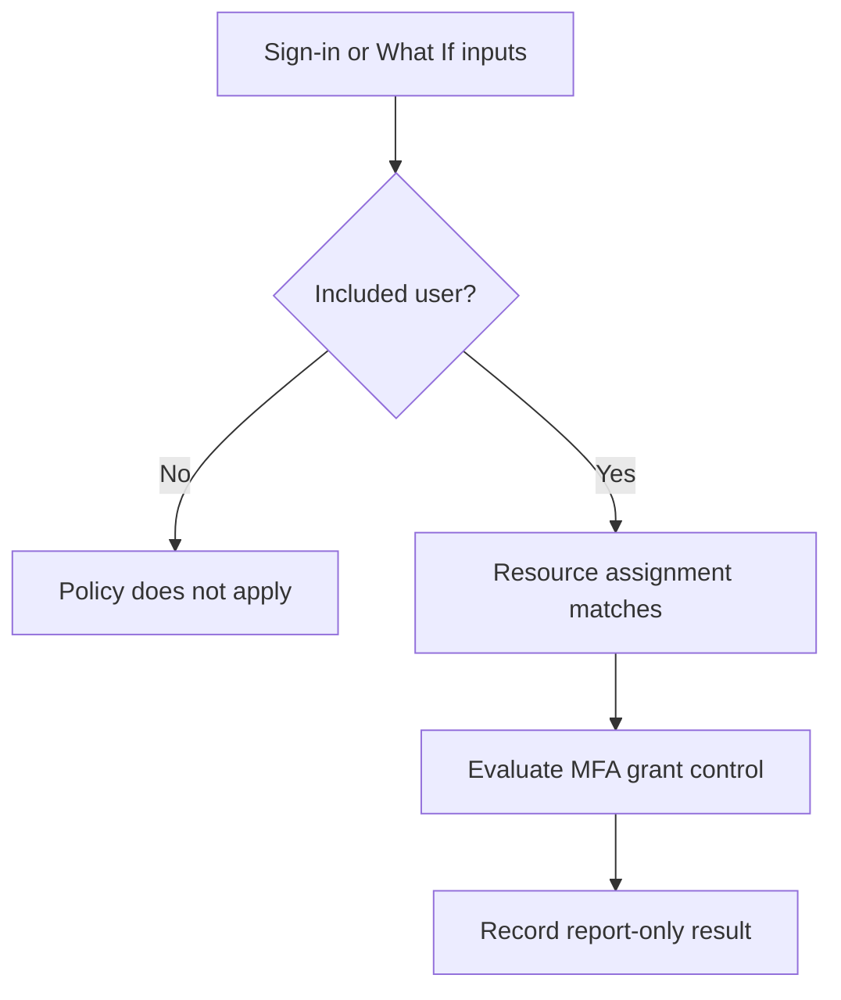

# Microsoft Entra Conditional Access: MFA Policy Evaluation Lab

**Author:** Farhan Muntasir | [GitHub: farhan115](https://github.com/farhan115)  
**Date:** November 11, 2026  
**Focus:** SC-300 — Conditional Access assignments, MFA grant controls, What If testing, and sign-in log analysis

## Overview

Created a Conditional Access policy requiring multifactor authentication for one test user across all resources. Kept the policy in **Report-only** mode, validated matching and nonmatching users with What If, and reviewed real sign-in events.

**Outcome:** The policy matched the intended user, did not match an out-of-scope user, and returned **Report-only: Success** for a successful real sign-in. This lab did not enforce the policy or verify a newly triggered MFA challenge.

## Environment

| Component | Configuration |
|---|---|
| Identity platform | Microsoft Entra ID |
| Administration | Entra admin center and Microsoft 365 admin center |
| Test account | CA-LabUser |
| Negative-test account | Alex Wilber |
| Licensing | Entra ID P2 assigned to the test user, confirmed by the lab operator |
| Browser testing | Private/incognito sign-in session |
| Policy state | Report-only |

## Policy Configuration

| Setting | Value |
|---|---|
| Name | LAB-CA-Require-MFA-TestUser |
| Identity scope | Users and groups |
| Included user | CA-LabUser only |
| Target resources | All resources |
| Grant | Grant access; require multifactor authentication |
| Additional conditions | None configured |
| Session controls | None configured |
| State | Report-only |

The administrator was outside the included user scope. Security defaults were left unchanged during this lab.

## Evaluation Flow



Report-only evaluation records the policy outcome without enforcing its grant controls. Other authentication requirements can still affect the sign-in.

## Implementation

### 1. Prepare the Test User

Created `CA-LabUser` as a member account. The initial user license view showed no assignments. In Microsoft 365 admin center, opened **Users → Active users → CA-LabUser → Licenses and apps** and assigned an available Microsoft Entra ID P2 license.

**Observation:** A successful save banner alone did not prove assignment. One screenshot still showed an unchecked P2 box and `Licenses (0)`. The checkbox needed to be selected before saving; the operator subsequently confirmed the assignment.

### 2. Create the Policy

In **Conditional Access → Policies → New policy**:

1. Entered `LAB-CA-Require-MFA-TestUser`.
2. Included only `CA-LabUser`.
3. Selected **All resources**.
4. Selected **Grant access → Require multifactor authentication**.
5. Left extra conditions and session controls unconfigured.
6. Selected **Report-only** and created the policy.

The policies list confirmed the new policy's Report-only state. An existing executives/Office 365 report-only policy was also present.

### 3. Positive What If Test

| Input | Value |
|---|---|
| User | CA-LabUser |
| Resource | Microsoft Office Licensing Service |
| Device platform | Windows |
| Client app | Browser |

**Observed:** `LAB-CA-Require-MFA-TestUser` appeared under **Policies that will apply**, with **Require multifactor authentication** and **Report-only** state.

A search for Microsoft Azure Management initially returned no results. Searching for Microsoft exposed available resources, and Microsoft Office Licensing Service was used for the simulation instead.

What If simulates policy applicability. It does not sign the user into the selected service or perform MFA. Windows and Browser were simulation inputs, not newly added policy conditions.

### 4. Negative What If Test

Changed the simulated user to **Alex Wilber**, retaining the other test inputs.

**Observed:** No policies appeared under **Policies that will apply**. The lab policy appeared under **Policies that will not apply**, with reason **Users and groups**.

This confirmed that the user assignment limited the policy's scope. It did not prove that the account was exempt from other tenant protections.

### 5. Generate a Real Sign-In

Opened `https://myaccount.microsoft.com` in a private browser window and signed in as CA-LabUser. An initial sign-in problem was investigated, and a later screenshot confirmed the account reached its My Account homepage.

### 6. Inspect Sign-In Events

Opened sign-in logs in the administrator session, filtered **User contains CA-LabUser**, and reviewed interactive sign-ins.

| Event time (UTC) | Application | Observed result |
|---|---|---|
| 2026-11-11 17:58:21 | My Profile | Failure; exact cause not inspected in this lab |
| 2026-11-11 17:58:39 | My Profile | Interrupted; additional details identified an expired password |
| 2026-11-11 18:02:01 | My Profile | Success |

The interrupted event's report-only tab showed a truncated **User action…** result, consistent with user action being required; the full text was not captured. Its Basic info explicitly identified password expiration as the interruption reason. The report-only policy was not the enforcement cause.

For the successful event, opened the report-only policy details:

| Detail | Observed value |
|---|---|
| Policy | LAB-CA-Require-MFA-TestUser |
| Policy state | Report-only |
| Result | Report-only: Success |
| User | CA-LabUser — Matched |
| Resource | Microsoft Graph — Matched |
| Additional conditions | Not configured |

The real event targeted **Microsoft Graph**, while What If used **Microsoft Office Licensing Service**. Both were covered by the policy's All resources assignment.

### 7. Inspect Authentication Details

The successful event's Authentication details tab stated:

> No authentication events were triggered as part of the authentication.

No password or MFA method was listed for this event. An existing session or token is a possible explanation, but the captured evidence does not establish the precise mechanism.

**Interpretation:** Report-only Success indicates the matching policy's controls were satisfied for that request. It does not establish that this policy caused an MFA prompt, that a new MFA challenge occurred, or which authentication method was used.

## Troubleshooting and Lessons

| Issue | Investigation and resolution |
|---|---|
| Test user initially unlicensed | Checked individual license assignments and assigned an existing P2 seat through Microsoft 365 admin center |
| Policy validation error | Configured the missing MFA grant control |
| Resource search returned no results | Broadened the search and selected an available resource for What If |
| Logs initially displayed administrator events | Applied an explicit CA-LabUser filter |
| Successful event initially absent | Refreshed logs; the later success event became visible |
| Interrupted sign-in | Basic info identified password expiration; later sign-in succeeded |
| Conditional Access list showed Not applied | Opened the separate Report-only tab to inspect the report-only policy result |
| No authentication method shown | Recorded the evidence limitation rather than claiming a newly completed MFA challenge |

## Validation Summary

| Test | Status |
|---|---|
| Policy created in Report-only mode | Verified |
| Included test user matched in What If | Verified |
| Out-of-scope user did not match | Verified |
| Nonmatching reason identified as Users and groups | Verified |
| Real test-user sign-in succeeded | Verified |
| Real report-only policy result was Success | Verified |
| User and resource assignment matches inspected | Verified |
| Expired-password interruption investigated | Verified |
| New MFA challenge and authentication method | Not established by captured event |
| Policy enforcement | Not performed |

## SC-300 Takeaways

- User assignments and target resources determine whether a policy applies.
- Selecting All resources does not mean all users are included.
- Grant controls define the access requirements after the policy matches.
- What If tests a hypothetical sign-in; sign-in logs provide evidence from real requests.
- Report-only evaluation differs from policy enforcement and overall sign-in status.
- A sign-in can be interrupted by a password issue while a report-only policy is evaluated separately.
- Review the Report-only tab rather than relying solely on the list's Conditional Access column.
- Report-only Success does not prove a fresh MFA prompt occurred.
- Member user type does not establish the absence of administrative roles.

## Interview Questions and Answers

### 1. What did you configure?

A report-only Conditional Access policy requiring MFA for one test user across all resources. I validated its user scope using What If and inspected real sign-in policy results.

### 2. Why start in Report-only mode?

It allows evaluation of policy impact without enforcing the policy's controls. I could inspect matching behavior and results before considering enforcement.

### 3. What is the difference between assignments and grant controls?

Assignments identify which users and resources are in scope. Grant controls specify requirements, such as MFA, for matching requests.

### 4. How did you prove the policy was scoped correctly?

CA-LabUser appeared in Policies that will apply. Alex Wilber appeared in Policies that will not apply with the reason Users and groups.

### 5. Does What If perform authentication?

No. It evaluates the supplied sign-in scenario against policies. It does not authenticate the user or trigger MFA.

### 6. What did Report-only: Success tell you?

The policy matched and its configured controls were satisfied for the request. It did not show that this policy enforced authentication or triggered a fresh MFA prompt.

### 7. Why did the sign-in list show Not applied?

That list value did not provide the separate report-only evaluation. I opened the event's Report-only tab to inspect the lab policy's result.

### 8. How did you diagnose the interrupted sign-in?

I reviewed Basic info and Additional details, which explicitly identified an expired password. I then verified a later successful sign-in.

### 9. What did the Authentication details tab prove?

It showed no authentication events for that request. The exact MFA method and whether a new challenge occurred were not established by this event.

### 10. What does Not configured mean beside a condition?

The policy did not restrict matching based on that condition. A displayed device platform or location can be sign-in context without being a configured policy restriction.

### 11. Did you disable Security defaults?

No. The lab remained report-only and left Security defaults unchanged. Any authentication prompts from other requirements must be investigated separately.

### 12. What would you do before enforcing this in a real environment?

Review report-only evidence, confirm intended scope, prepare emergency access and recovery procedures, check overlapping policies and authentication readiness, and stage deployment. Those production rollout activities were outside this lab.

## Resume Bullet

- Configured an MFA Conditional Access policy in Microsoft Entra ID Report-only mode; validated 2 user-scope scenarios with What If, analyzed real sign-in logs, and confirmed matched user/resource assignments with a Report-only Success result.

## Screenshot Evidence

Upload your screenshots into a `screenshots` folder and use these suggested names. Redact public IP addresses, tenant/user identifiers, and request identifiers where appropriate before publishing.

| Suggested filename | Evidence |
|---|---|
| policy-report-only.png | Created policy in Report-only state |
| what-if-included-user.png | CA-LabUser policy match |
| what-if-out-of-scope.png | Users and groups nonmatch |
| password-expired.png | Interrupted event explanation |
| successful-sign-in.png | Successful CA-LabUser event |
| report-only-success.png | Matched user/resource and Success |
| authentication-details.png | No authentication events listed |

After uploading the images, embed them using relative paths:

```markdown

```

## Final State and Scope

The policy remains **Report-only**. No enforced Conditional Access MFA test was performed. The report documents a learning tenant and does not claim production IAM administration experience.

## Author

**Farhan Muntasir**  
[GitHub: farhan115](https://github.com/farhan115)
