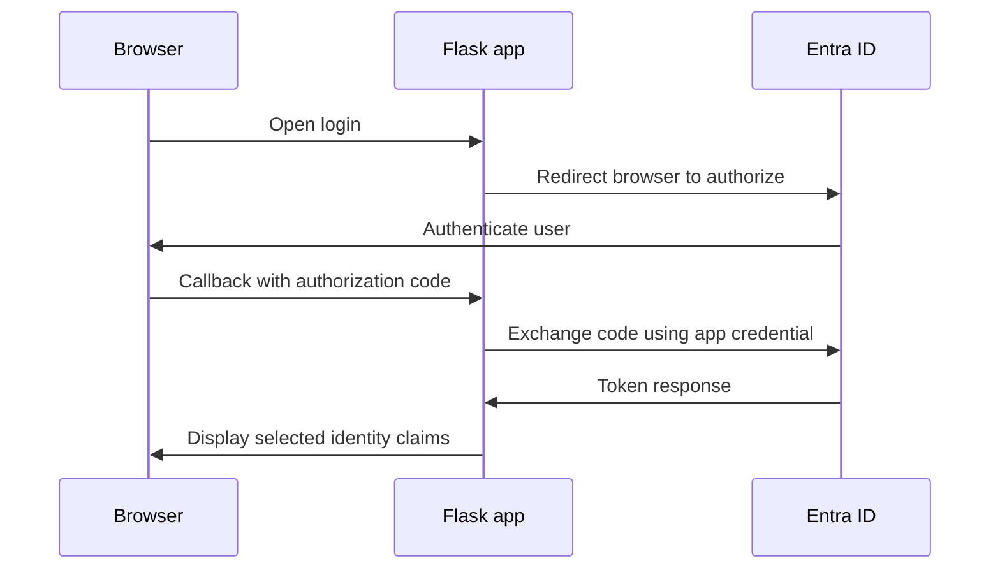

# Microsoft Entra ID OIDC Authentication & Troubleshooting Lab

**Author:** Farhan Muntasir | [GitHub](https://github.com/farhan115)  
**Project type:** Personal IAM lab | **Status:** Baseline, failure, and recovery verified

## Overview

Integrated a local Python Flask application with Microsoft Entra ID using OpenID Connect (OIDC) and MSAL. Verified successful authentication, deliberately introduced a redirect URI mismatch, observed Entra's `AADSTS50011` rejection, and restored sign-in by correcting the local configuration.

This project demonstrates identity integration, application troubleshooting, security-control validation, and technical documentation. These skills support collaboration with application owners and security teams. The exercise uses a local development application rather than production infrastructure.

## Results

| Metric | Verified result |
|---|---|
| Application registrations | 1 single-tenant Web application |
| Authentication scenarios | 3: initial success, mismatch rejection, restored success |
| Displayed ID token claims | 6: `aud`, `iss`, `name`, `oid`, `preferred_username`, `tid` |
| Configuration fault | 1 unregistered redirect URI |
| Observed error | `AADSTS50011` |
| Recovery | Correct redirect URI restored and sign-in verified |

These are 3 scenarios within **1 project**, not 3 separate projects.

## Authentication flow



The authorization code returns through the browser. The app exchanges it for tokens through a server-side request. MSAL manages the authentication flow and its state/nonce checks. The app displays selected claims from `id_token_claims`; it does not render raw tokens.

## Tools

- Microsoft Entra ID app registration
- Python 3 and an isolated virtual environment
- Flask, MSAL for Python, python-dotenv
- Windows PowerShell and a browser
- Local endpoint: `http://localhost:5000`

## Files

| File or folder | Purpose |
|---|---|
| `app.py` | Local Flask OIDC application |
| `.env.example` | Configuration template containing placeholders only |
| `.gitignore` | Excludes local credentials, environment, and Python cache |
| `requirements.txt` | Dependencies matching the versions shown during installation |
| `images/` | Screenshots of registration, success, rejection, and recovery |

## 1. Register the application

In the [Entra admin center](https://entra.microsoft.com), open **App registrations > New registration**.

| Setting | Value |
|---|---|
| Name | `OIDC-Network-Security-Lab` |
| Account type | Accounts in this organizational directory only |
| Platform | Web |
| Redirect URI | `http://localhost:5000/auth/callback` |

Record the Application (client) ID and Directory (tenant) ID. Under **Certificates & secrets**, create a short-lived client secret and save its **Value**, not its Secret ID, locally.


## 2. Prepare Python

Run in PowerShell:

```powershell
mkdir "$HOME\OIDC-Network-Security-Lab"
cd "$HOME\OIDC-Network-Security-Lab"
python -m venv .venv
.\.venv\Scripts\python.exe -m pip install -r requirements.txt
```

Copy the project files into this directory before the installation command. In the original execution, `py` was not recognized; using the available `python` command allowed environment creation.

## 3. Configure locally

```powershell
Copy-Item .env.example .env
notepad .env
```

Fill in the placeholders:

```dotenv
TENANT_ID=YOUR_DIRECTORY_TENANT_ID
CLIENT_ID=YOUR_APPLICATION_CLIENT_ID
CLIENT_SECRET=YOUR_CLIENT_SECRET_VALUE
REDIRECT_URI=http://localhost:5000/auth/callback
FLASK_SECRET_KEY=YOUR_RANDOM_SESSION_KEY
```

Generate a session-signing key:

```powershell
.\.venv\Scripts\python.exe -c "import secrets; print(secrets.token_hex(32))"
```

Paste the result into `FLASK_SECRET_KEY`. Keep `.env`, credentials, raw tokens, and virtual environments out of Git. `.gitignore` does not remove a file that was already committed.

## 4. Run and verify the baseline

```powershell
.\.venv\Scripts\python.exe app.py
```

Open `http://localhost:5000` and select **Sign in with Microsoft**. Use an account in the registered tenant. Keep the hostname as `localhost` throughout the flow so the session cookie is available at the callback.

**Observed:** Sign-in successful and a table containing 6 claims.


## ID token claims

| Claim | Meaning | How used in this lab |
|---|---|---|
| `aud` | Intended audience | Compared with the registered client ID |
| `iss` | Issuer | Inspected the tenant-specific Entra issuer |
| `tid` | Tenant ID | Compared with the configured tenant |
| `oid` | User object ID within the tenant | Identifies the tenant's user object |
| `name` | Display name | Human-readable identity display |
| `preferred_username` | Human-readable username | Display only; can change and should not be a permanent identifier |

Claim inspection in this UI is distinct from independently implementing JWT signature verification. This lab relies on MSAL's supported authentication-code flow rather than a custom token parser.

## 5. Introduce a redirect URI mismatch

Leave the Entra registration unchanged. Stop Flask with **Ctrl+C** and edit `.env`:

```dotenv
REDIRECT_URI=http://localhost:5000/auth/wrong-callback
```

Restart the app, clear its local sign-in session, and initiate a new sign-in.

**Observed:** Entra rejected the request with `AADSTS50011`, stating that the requested redirect URI did not match the application's configured redirect URIs.


## 6. Diagnose and recover

| Item | Finding |
|---|---|
| Symptom | Microsoft sign-in error page |
| Error code | `AADSTS50011` |
| Requested URI | `http://localhost:5000/auth/wrong-callback` |
| Registered URI | `http://localhost:5000/auth/callback` |
| Root cause | Local redirect URI did not match app registration |
| Correction | Restore the registered callback in `.env` |
| Verification | Restart Flask and complete a fresh sign-in |

Restore:

```dotenv
REDIRECT_URI=http://localhost:5000/auth/callback
```

Restart:

```powershell
.\.venv\Scripts\python.exe app.py
```

Open the homepage and begin a fresh login instead of refreshing the old error page.

**Observed:** Sign-in successful and the claims table returned.


## Validation summary

| Scenario | Expected | Observed | Result |
|---|---|---|---|
| Initial authentication | Successful sign-in | Claims table displayed | Pass |
| Wrong callback URI | Entra rejects redirect | `AADSTS50011` shown | Pass |
| Restored callback URI | Successful fresh sign-in | Claims table displayed | Pass |

## Troubleshooting guide

| Symptom | Check / action |
|---|---|
| `py` is not recognized | Try `python --version`, then `python -m venv .venv`. |
| Missing environment variable | Confirm `.env` exists beside `app.py`, contains all 5 keys, and is not named `.env.txt`. |
| Module not found | Install dependencies with the same `.venv` interpreter used to run the app. |
| `AADSTS50011` | Compare the redirect URI sent by the app with the registered Web redirect URI. |
| Invalid client credential | Check secret Value versus Secret ID, expiration, and application registration. Never print the secret. |
| Sign-in session expired | Return to the homepage and begin a fresh flow; pending flows expire after 10 minutes or an app restart. |
| Browser cannot connect | Keep Flask running and check that local port 5000 is available. |
| Local logout followed by immediate sign-in | The app cleared its session, but the Microsoft browser session can remain active. |

## Implementation boundaries

- Single-process, local development lab bound to loopback; debug mode disabled.
- Pending authentication flows are kept in process memory, not a shared production session store.
- Selected display claims are held in Flask's signed cookie. Signed cookies are not encrypted; raw tokens and client secrets are not stored there.
- `/logout` clears the local app session, not the Entra browser session.
- The callback validates authentication through MSAL; the lab does not implement group/role-based authorization.
- The code uses OIDC sign-in scopes supplied by MSAL and does not call Microsoft Graph.

## Resume bullet

- Built a Microsoft Entra ID OIDC integration using Python Flask and MSAL; verified 3 authentication scenarios, inspected 6 identity claims, and resolved an AADSTS50011 redirect URI mismatch to restore sign-in.

## Interview questions and answers

### 1. What did you build?

A single-tenant Entra ID sign-in integration for a local Flask app. I verified baseline authentication, deliberately caused a redirect URI mismatch, and restored successful sign-in after correcting the configuration.

### 2. What is OpenID Connect?

OIDC is an identity layer built on OAuth 2.0. It supports user authentication and supplies an ID token containing claims about the authenticated user and sign-in context.

### 3. How does OIDC differ from OAuth 2.0?

OAuth 2.0 concerns delegated access to resources. OIDC adds a standardized authentication layer. An ID token describes authentication for the client; an access token is intended for a resource API.

### 4. What is the authorization code flow?

The browser receives an authorization code at the app's callback. The app exchanges that code at the token endpoint. For this confidential web client, the app authenticates itself using its client credential during the exchange.

### 5. What caused AADSTS50011?

The app requested `/auth/wrong-callback`, but only `/auth/callback` was registered. Entra refused the redirect because it was not an allowed destination for that application.

### 6. How did you resolve the issue?

I compared the requested and registered URIs, restored the local configuration, restarted Flask, and completed a fresh sign-in. The claims table confirmed the baseline behavior returned.

### 7. Why validate redirect URIs?

It restricts where an authorization response may be sent for a client application. This prevents the application from freely choosing an arbitrary callback destination.

### 8. What is the difference between a client ID and client secret?

The client ID identifies an application. The client secret is a credential used by the confidential client to authenticate itself. The client ID can appear in documentation; the secret must remain private.

### 9. Why use a single-tenant registration?

It limits the application's account audience to its configured tenant, including eligible tenant guest accounts. It does not independently implement application-specific authorization.

### 10. What are aud and iss?

`aud` is the token's intended audience. `iss` identifies its issuer. Both matter when establishing that a token is intended for the app and comes from the expected identity authority.

### 11. What is the difference between tid and oid?

`tid` identifies the tenant. `oid` identifies a user object within that tenant. Their combination can distinguish tenant-scoped identities.

### 12. Why avoid preferred_username as a permanent key?

It is human-readable and can change. Use stable identifiers appropriate to the application's identity model, such as the tenant and object ID pair, instead of relying on a display username.

### 13. What does state protect?

It correlates the authentication response with the login request and helps defend against login CSRF. The app preserves MSAL's flow data server-side and supplies it when processing the callback.

### 14. What is nonce for?

It links an ID token to the authentication request and helps detect replay in the authentication flow. MSAL manages this through the paired flow APIs used here.

### 15. Why use MSAL?

It provides Microsoft's supported authentication flow implementation, including generating the authorization request and processing its response. This avoids writing a custom protocol implementation for the lab.

### 16. Does the app perform authorization?

It establishes a signed-in session and displays selected claims. It does not enforce access through groups, roles, or resource permissions; those would be a separate extension.

### 17. What does the logout link do?

It removes the Flask session and any associated pending flow. It does not end the user's Microsoft browser session, so subsequent sign-in may reuse that session.

### 18. Why is localhost consistency important?

`localhost` and `127.0.0.1` are different browser hostnames for cookie purposes. Starting on one and returning to the other can lose the session needed to correlate the flow.

### 19. How did you protect credentials in the repository?

The repository includes a placeholder-only `.env.example`, excludes `.env` and `.venv`, and does not contain a secret or raw token. If a secret is committed accidentally, excluding the file afterward is insufficient: revoke or rotate it and remove the exposed material appropriately.

### 20. How does this relate to a security engineering role?

It demonstrates validating an identity control, collaborating around application configuration, reproducing a failure, documenting its root cause, and verifying service restoration. It complements network-security skills without claiming production firewall or network engineering experience.

## GitHub publishing

Suggested repository: `entra-oidc-troubleshooting-lab`

Suggested description:

> Microsoft Entra ID OIDC lab using Flask and MSAL: validate sign-in, inspect 6 identity claims, reproduce AADSTS50011, and verify recovery across 3 authentication scenarios.

Create a repository at [github.com/new](https://github.com/new). Extract this project's ZIP and upload the contents of the project folder so `README.md` and `app.py` are at the repository root. Include the `images` folder. Do not upload your real `.env` or `.venv`.

## References

- [MSAL Python authentication-code flow guidance](https://learn.microsoft.com/en-us/entra/msal/python/getting-started/acquiring-tokens)
- [MSAL Python API documentation](https://msal-python.readthedocs.io/en/latest/)
