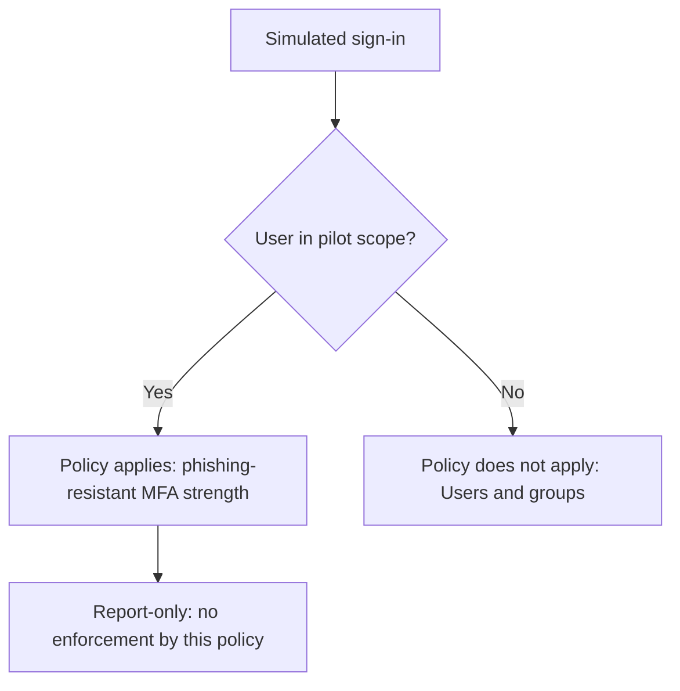

# Microsoft Entra ID — Phishing-Resistant MFA Pilot

**Author:** [Farhan Muntasir](https://github.com/farhan115)  
**Lab date:** November 12, 2026  
**Scope:** One report-only Conditional Access policy, one pilot group, and two What If test cases

## Overview

Configured a Microsoft Entra Conditional Access policy that specifies the built-in **Phishing-resistant MFA** authentication strength. Scoped the policy to a pilot security group, kept it in **Report-only**, and validated its applicability for an included user and a user outside the pilot using the What If tool.

**Verified outcome:** the policy applied to the pilot user's simulated sign-in and did not apply to the non-pilot user's simulation, with **Users and groups** shown as the reason.

This project demonstrates configuration and scope validation in a personal lab. It does not claim production deployment, successful phishing-resistant authentication, blocked attacks, or real sign-in log evaluation.

## Business objective

Prepare stronger authentication for a limited pilot before enforcement. Validate who would be targeted, document the control, and avoid expanding the policy to unintended users. A production rollout would also need method readiness checks, sign-in evidence, recovery planning, and stakeholder approval.

## Policy configuration

| Setting | Implemented value |
|---|---|
| Policy name | `LAB-CA-Require-PhishingResistant-MFA` |
| Included group | `LAB-CA-PhishingResistant-Pilot` |
| Group type / membership | Security / Assigned |
| Verified direct member | Bianca Pisani |
| Target resources | All resources, formerly All cloud apps |
| Network | Not configured |
| Conditions | None configured |
| Grant | Grant access |
| Grant requirement | Require authentication strength |
| Authentication strength | Phishing-resistant MFA |
| Standard Require MFA checkbox | Not selected |
| Session controls | None configured |
| Policy state | Report-only |

**Group description:** Pilot group for testing a report-only Conditional Access policy requiring phishing-resistant MFA. Contains designated non-admin test users to evaluate policy scope and sign-in impact before enforcement.

Bianca's direct group membership was verified. Her role assignments were not independently validated in this exercise.

## Prerequisites

- A personal Microsoft Entra tenant with Conditional Access licensing, generally Entra ID P1 or higher for this scenario.
- An administrator permitted to manage Conditional Access, such as Conditional Access Administrator.
- Two test identities: one inside the pilot group and one outside it.
- An available cloud application for What If simulation.

Use a lab tenant. This exercise does not require switching the policy to On or disabling Security defaults. The captured interface displayed a Security defaults warning; the report-only policy was nevertheless saved successfully. This project does not establish the tenant's overall protection state.

## Evaluation flow



Other policies and protections must be assessed separately. A What If result describes the supplied scenario, not every possible sign-in.

## 1. Create and verify the pilot group

In the Entra admin center, open **Groups → All groups → New group**. Create an Assigned Security group named `LAB-CA-PhishingResistant-Pilot` and add the designated test user.

Open the group's **Members** page and verify the intended identity.

## 2. Configure the Conditional Access policy

Open **Conditional Access → Policies → New policy**.

1. Enter `LAB-CA-Require-PhishingResistant-MFA`.
2. Under Users, choose Select users and groups and include the pilot group only.
3. Under Target resources, choose All resources.
4. Leave Network, Conditions, and Session controls unconfigured.
5. Under Grant, select Grant access and Require authentication strength.
6. Select Phishing-resistant MFA. Leave the separate Require multifactor authentication checkbox unchecked.
7. Keep Enable policy set to Report-only and create the policy.

## 3. Confirm the saved policy state

Return to the policy list and confirm the policy appears with state **Report-only**.

Report-only evaluates the policy without enforcing its access controls. What If is a separate simulation tool; the recorded results show simulated applicability, not real report-only sign-in outcomes.

## 4. Test the pilot user

Open **What If** and select:

| Simulation input | Value |
|---|---|
| Identity type | Users |
| User | Bianca Pisani |
| Target type | Cloud apps |
| Resource | Selected Microsoft Office Licensing resource |
| Resource application ID | `8d3a7d3c-c034-4f19-a2ef-8412952a9671` |
| Device platform | Windows |
| Client app | Browser |

Complete required fields before running the evaluation. Windows and Browser are simulation inputs; the saved policy itself has no platform or client-app condition configured.

Run What If. The lab policy appeared under **Policies that will apply**, with **Authentication strength - Phishing-resistant MFA** and state **Report-only**.

## 5. Test a user outside the pilot

Change only the test identity to **Cameron White**, retaining the same application, Windows platform, and Browser client.

Run the evaluation. The **Policies that will apply** tab showed **0 policies found** for this scenario.

Open **Policies that will not apply**. The lab policy appeared with **Users and groups** as its non-applicability reason.

## Validation results

| Test | Expected | Observed | Result |
|---|---|---|---|
| Saved policy | Report-only | Report-only in policy list | Passed |
| Pilot membership | Bianca in group | Direct membership displayed | Passed |
| Pilot simulation | Lab policy applies | Listed under Policies that will apply | Passed |
| Authentication strength | Phishing-resistant MFA | Displayed in applicable policy result | Passed |
| Non-pilot simulation | Lab policy does not apply | Listed under Policies that will not apply | Passed |
| Non-pilot scope reason | User/group scope | Users and groups | Passed |

## Troubleshooting and interpretation

### The policy does not appear for the pilot user

Check the selected tenant, policy state, included group, effective membership, resource, and simulation inputs. Allow time for recent changes to propagate and rerun the evaluation. Inspect the non-applicability reason before changing settings.

### Authentication strength and Require MFA warning

The UI warns that Require authentication strength cannot be combined with the separate Require multifactor authentication grant control in the same policy. This lab selected authentication strength only.

### All resources versus one simulated cloud app

The policy targets All resources. The test selects one resource to evaluate a particular simulated sign-in. This does not narrow the saved policy to that one application.

### Zero applicable policies

The result means no evaluated policies applied to the provided simulation. It does not prove the account has no protection from any other security mechanism or that all sign-in scenarios are unrestricted.

## Interview questions and answers

### 1. What did you accomplish?
I configured one report-only Conditional Access policy requiring phishing-resistant MFA strength for a pilot group and validated two What If cases: an included user and an out-of-scope user.

### 2. What is Conditional Access?
It is Entra's policy engine for evaluating access signals and applying access requirements to targeted resources. A policy combines assignments, optional conditions, and access controls.

### 3. What is an authentication strength?
It defines which authentication method combinations can satisfy an access requirement. It lets administrators specify a stronger requirement than accepting any supported MFA method.

### 4. Which methods can satisfy phishing-resistant MFA?
Examples include FIDO2/passkeys, Windows Hello for Business, and certificate-based authentication configured for multifactor authentication. Method availability and configuration must be checked in the tenant; I did not register or test these methods in this exercise.

### 5. Is every MFA method phishing-resistant?
No. SMS codes, one-time codes, and standard push approval are not equivalent to the built-in phishing-resistant authentication strength. Being passwordless also does not automatically establish phishing resistance.

### 6. What does Report-only do?
It evaluates a policy without enforcing that policy's access controls. Real sign-in logs can provide report-only evaluation evidence; my verified evidence in this lab came from What If simulations.

### 7. How does What If differ from a real sign-in?
What If evaluates policy applicability for supplied inputs. It does not authenticate the user, register a credential, or prove that an authentication method satisfies an enforced policy.

### 8. Why use a pilot group?
It limits the initial scope and makes positive and negative targeting tests possible before broader rollout.

### 9. What did the positive test show?
For Bianca Pisani, a verified pilot member, the lab policy appeared under Policies that will apply with the phishing-resistant MFA strength and Report-only state.

### 10. What did the negative test show?
For Cameron White, the lab policy did not apply. The result gave Users and groups as the reason, confirming the scope boundary for that simulation.

### 11. Did the policy block a user?
No blocking was demonstrated. It remained Report-only, and the tests were simulations.

### 12. Did you deploy FIDO2 or Windows Hello for Business?
No. I configured a policy requirement referring to the built-in strength. Credential deployment and successful authentication are separate follow-up tasks.

### 13. Why leave the standard Require MFA checkbox unchecked?
The UI does not allow that grant control to be combined with Require authentication strength in the same policy. The selected strength already defines the accepted method combinations.

### 14. Why select Windows and Browser in What If?
They describe the simulated sign-in. They do not mean the saved policy is restricted to those inputs, because I left its Conditions unconfigured.

### 15. How would you prepare for enforcement?
Verify licensing, available authentication methods, user registration, application compatibility, emergency access, interactions with other policies, real report-only sign-in results, and a rollback plan. Then enforce a controlled pilot after review. Those steps were not completed here.

### 16. What is a suitable rollback action?
For a later enforced pilot, change the affected policy to Report-only or Off using an authorized administrator with verified access. This lab never enabled enforcement, and no rollback was executed.

### 17. Does the pilot group's scope provide application permissions?
No. Conditional Access imposes access conditions; it does not grant application authorization, app assignments, licenses, or directory roles by itself.

### 18. How would you explain the value to a client?
The lab provides evidence that the stronger authentication requirement targets the intended pilot user and excludes the comparison user before enforcement. Further evidence is needed to establish registration readiness and actual sign-in behavior.

### 19. What license is generally needed?
This Conditional Access scenario generally requires Entra ID P1 or higher for in-scope users. Risk-based controls require additional capabilities such as Entra ID P2; risk conditions were not configured here.

### 20. What are the limits of your evidence?
It covers one policy, one pilot group, and two simulated user cases. I did not verify real sign-in logs, method enrollment, enforcement, attack prevention, or production rollout.

## Resume bullet

- Configured **1 report-only Microsoft Entra Conditional Access policy** requiring phishing-resistant MFA for a pilot security group; validated **2 user scenarios** with What If, confirming policy applicability for an included user and user/group-based non-applicability for a non-pilot user.

## Repository details and upload

**Suggested repository name:** `entra-phishing-resistant-mfa-pilot`

**Description:** Microsoft Entra Conditional Access lab using phishing-resistant MFA authentication strength, a report-only pilot policy, and positive/negative What If scope validation with interview Q&A.

In a new GitHub repository, choose Add file → Upload files and upload this README.md file. Commit with:

```text
Add Entra phishing-resistant MFA pilot and What If validation
```

For an existing IAM lab repository, place these contents in `entra-phishing-resistant-mfa-pilot/`. This package is documentation and evidence, not an exported or automatically deployable tenant policy.

## Optional cleanup

Keep the policy Report-only for portfolio reference, or delete only this lab policy when finished. Remove the lab group only after confirming no other assignments depend on it. Do not change unrelated tenant protections as part of cleanup.

## References

- [Microsoft: Authentication strengths](https://learn.microsoft.com/en-us/entra/identity/authentication/concept-authentication-strengths)
- [Microsoft: Plan phishing-resistant authentication deployment](https://learn.microsoft.com/en-us/entra/identity/authentication/how-to-deploy-phishing-resistant-passwordless-authentication)
- [Microsoft: Plan Conditional Access deployment](https://learn.microsoft.com/en-us/entra/identity/conditional-access/plan-conditional-access)
