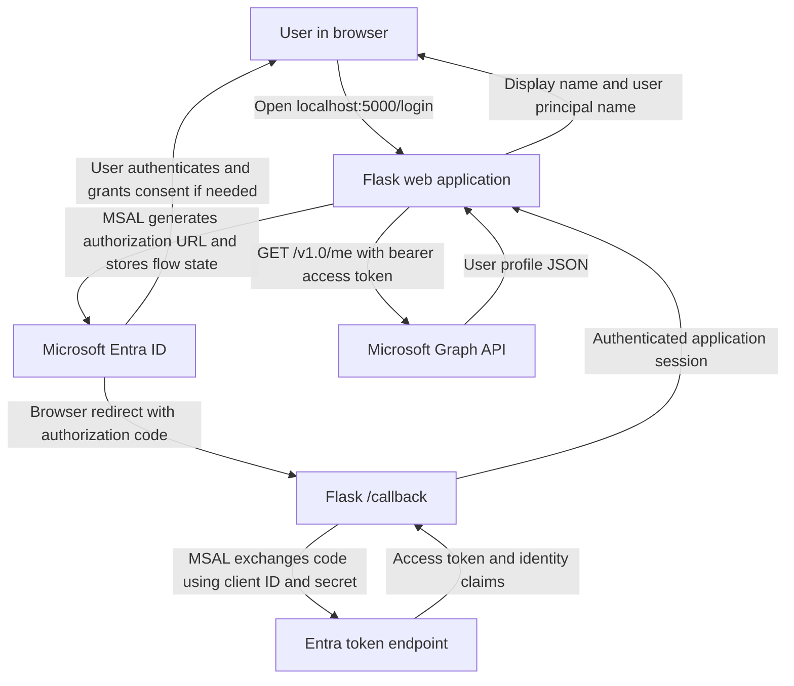

# Microsoft Entra ID OAuth 2.0 Authorization Code Flow — Flask IAM Lab

**Author:** Farhan Muntasir  
**GitHub:** [farhan115](https://github.com/farhan115)  
**Repository:** [microsoft-entra-oauth2-flask-lab](https://github.com/farhan115/microsoft-entra-oauth2-flask-lab)  
**Lab date:** November 10, 2026  
**Status:** Authentication, Microsoft Graph `/me`, and basic negative tests completed successfully.

## 1. Project overview

Built a local Python Flask web application integrated with **Microsoft Entra ID** using the **OAuth 2.0 Authorization Code Flow** through the **Microsoft Authentication Library (MSAL)**. The application signs in an organizational user, obtains an access token for Microsoft Graph using a confidential client, calls the delegated `/me` endpoint, and displays the signed-in user's profile.

This project demonstrates identity application registration, delegated API permissions, redirect URI configuration, secure configuration practices, authentication troubleshooting, and basic session/callback testing. It is a **hands-on lab**, not a production deployment.

### Learning objectives

- Register a single-tenant web application in Microsoft Entra ID.
- Configure a localhost redirect URI and disable legacy implicit grant options.
- Request delegated Microsoft Graph `User.Read` permission.
- Implement an authorization code flow with MSAL for Python.
- Handle successful and failed token responses safely.
- Call Microsoft Graph with a bearer access token.
- Test unauthenticated routes, logout behavior, and missing callback state.
- Prevent local credentials and virtual environments from being committed to Git.

## 2. Technology stack

| Component | Purpose |
|---|---|
| Microsoft Entra ID | Identity provider and OAuth authorization server |
| OAuth 2.0 | Delegated API authorization |
| OpenID Connect (OIDC) | Authentication identity claims through an ID token |
| MSAL for Python | Authorization code flow and token acquisition |
| Python / Flask | Local web application and routes |
| Microsoft Graph API | Profile data endpoint `/v1.0/me` |
| `python-dotenv` | Loads environment variables from `.env` |
| `requests` | HTTPS request to Microsoft Graph |
| Git / GitHub | Source control and documentation |

## 3. Architecture



**Important distinction:** The **authorization code** is exchanged at the token endpoint; it is not itself a Graph access token. The **access token** authorizes calls to Microsoft Graph, while OIDC **ID token claims** describe the authenticated user to the client application.

### Request flow

1. Browser visits `/login`.
2. MSAL creates an authorization request and the app stores the flow in the Flask session.
3. Browser is redirected to Microsoft Entra ID.
4. The user authenticates; Entra returns an authorization code to `/callback`.
5. MSAL checks the authorization response and exchanges the code at the token endpoint.
6. The app checks for an `access_token` before using it.
7. The app stores session data and redirects to the home page.
8. `/profile` calls `https://graph.microsoft.com/v1.0/me` with `Authorization: Bearer <token>`.
9. The app displays the signed-in user's display name and user principal name.

## 4. Microsoft Entra configuration

| Setting | Lab configuration |
|---|---|
| App registration | `Entra-OAuth2-IAM-Lab` |
| Supported account types | Single tenant (organizational directory only) |
| Platform | Web |
| Redirect URI | `http://localhost:5000/callback` |
| Implicit access tokens | Disabled |
| Implicit ID tokens | Disabled |
| Public client flows | Disabled |
| API | Microsoft Graph |
| Permission | Delegated `User.Read` |
| Client authentication | Client secret (lab only) |

**Admin consent:** The permission listing indicated `User.Read` did not require admin consent by default. Whether a user can grant consent still depends on tenant policies.

## 5. Project layout

```text
Entra-OAuth2-IAM-Lab/
├── app.py
├── .env.example
├── .gitignore
├── requirements.txt
├── README.md
├── screenshots/             # Optional sanitized evidence
├── .env                     # LOCAL ONLY — never commit
├── .venv/                   # LOCAL ONLY — never commit
└── __pycache__/             # LOCAL ONLY — never commit
```

### `.gitignore`

```gitignore
.env
.env.*
!.env.example
.venv/
__pycache__/
*.pyc
.flask_session/
```

### `.env.example`

```dotenv
CLIENT_ID=replace-with-application-client-id
TENANT_ID=replace-with-directory-tenant-id
CLIENT_SECRET=replace-with-new-client-secret-value
REDIRECT_URI=http://localhost:5000/callback
```

Never publish a real `.env` file, secret value, authorization code, access token, refresh token, browser cookie, or unredacted authentication log. The **secret Value**, not **Secret ID**, must be used for `CLIENT_SECRET`.

## 6. Installation and run instructions

Prerequisites: Python 3, access to a Microsoft Entra tenant, an app registration configured as above, and Git.

### Windows PowerShell

```powershell
cd "$HOME\Desktop\Entra-OAuth2-IAM-Lab"
python -m venv .venv
.\.venv\Scripts\Activate.ps1
python -m pip install flask msal python-dotenv requests
python -m pip freeze > requirements.txt
Copy-Item .env.example .env
```

Edit `.env` locally with your **own** app registration's client ID, tenant ID, newly created secret **Value**, and exact redirect URI. Do not paste credentials into chat or GitHub.

Start the server:

```powershell
python -m py_compile app.py
python app.py
```

Visit `http://localhost:5000`, click **Login with Microsoft**, and then **View Microsoft Graph Profile**. Keep the local Flask development server for learning only; it is not a production WSGI deployment.

## 7. Application implementation

The following is a **reference implementation based on the completed lab**. The repository's `app.py` should be reviewed against it before publishing. The `load_dotenv(override=True)` setting helps ensure a recently updated local `.env` replaces stale shell values during troubleshooting.

```python
import os
import secrets

import msal
import requests
from dotenv import load_dotenv
from flask import Flask, redirect, request, session, url_for
from markupsafe import escape

load_dotenv(override=True)

app = Flask(__name__)
app.secret_key = secrets.token_hex(32)
app.config.update(
    SESSION_COOKIE_HTTPONLY=True,
    SESSION_COOKIE_SAMESITE="Lax",
)

CLIENT_ID = os.environ["CLIENT_ID"]
TENANT_ID = os.environ["TENANT_ID"]
CLIENT_SECRET = os.environ["CLIENT_SECRET"]
REDIRECT_URI = os.getenv("REDIRECT_URI", "http://localhost:5000/callback")
AUTHORITY = f"https://login.microsoftonline.com/{TENANT_ID}"
SCOPES = ["User.Read"]


def build_msal_app():
    return msal.ConfidentialClientApplication(
        CLIENT_ID,
        authority=AUTHORITY,
        client_credential=CLIENT_SECRET,
    )


@app.route("/")
def home():
    if "user" in session:
        return (
            "<h2>Microsoft Entra ID OAuth Lab</h2>"
            "<p>Authentication successful!</p>"
            '<a href="/profile">View Microsoft Graph Profile</a>'
            '<p><a href="/logout">Logout</a></p>'
        )
    return '<h2>Entra OAuth Lab</h2><a href="/login">Login with Microsoft</a>'


@app.route("/login")
def login():
    flow = build_msal_app().initiate_auth_code_flow(
        scopes=SCOPES,
        redirect_uri=REDIRECT_URI,
    )
    session["auth_flow"] = flow
    return redirect(flow["auth_uri"])


@app.route("/callback")
def callback():
    flow = session.pop("auth_flow", None)
    if not flow:
        return "Missing authentication flow", 400

    try:
        result = build_msal_app().acquire_token_by_auth_code_flow(
            flow,
            request.args.to_dict(),
        )
    except ValueError:
        return "Invalid authentication response", 400

    if "access_token" not in result:
        # Avoid logging token contents, authorization codes, or secret values.
        print("OAuth error:", result.get("error"))
        return "Authentication failed. Check server logs.", 400

    session["user"] = result.get("id_token_claims", {})
    session["access_token"] = result["access_token"]
    return redirect(url_for("home"))


@app.route("/profile")
def profile():
    token = session.get("access_token")
    if not token:
        return redirect(url_for("login"))

    try:
        response = requests.get(
            "https://graph.microsoft.com/v1.0/me",
            headers={"Authorization": f"Bearer {token}"},
            timeout=10,
        )
    except requests.RequestException:
        return "Microsoft Graph connection failed", 502

    if not response.ok:
        return f"Microsoft Graph request failed: {response.status_code}", 502

    user = response.json()
    return (
        "<h2>Microsoft Graph Profile</h2>"
        f"<p>Name: {escape(user.get('displayName', ''))}</p>"
        f"<p>Email: {escape(user.get('userPrincipalName', ''))}</p>"
        '<a href="/">Home</a>'
    )


@app.route("/logout")
def logout():
    session.clear()
    return redirect(url_for("home"))


if __name__ == "__main__":
    app.run(host="127.0.0.1", port=5000, debug=False)
```

**Security limitation of this lab implementation:** Flask's default session is a **signed client-side cookie**, not encrypted server-side token storage. Storing `access_token` in that session is unsuitable for production. Use server-side session storage and MSAL token cache, HTTPS, persistent protected signing keys, CSRF-aware logout, and a deliberate Microsoft Entra logout strategy before deployment. The local `/logout` route clears the Flask session; it does **not** necessarily terminate the Microsoft Entra browser SSO session.

## 8. Ten-step lab record

| Step | Activity | Observed result |
|---|---|---|
| 1 | Registered the single-tenant app | Completed |
| 2 | Configured Web redirect and disabled implicit flow | Completed |
| 3 | Verified delegated Microsoft Graph `User.Read` | Completed |
| 4 | Created a client secret | Completed; secret troubleshooting required |
| 5 | Set up Flask, MSAL, `requests`, and `python-dotenv` | Completed |
| 6 | Built local OAuth web app and `.env` configuration | Completed |
| 7 | Debugged authorization code flow and achieved sign-in | Completed |
| 8 | Called Microsoft Graph `/me` | Completed; profile displayed |
| 9 | Tested logout, missing callback flow, and Git ignore rules | Completed basic tests |
| 10 | Created GitHub repository and documented project | Repository created; documentation prepared |

## 9. Test evidence

| Test | Expected | Observed |
|---|---|---|
| Open `/` without app session | Login link | Login page displayed |
| Sign in with Microsoft | Authenticated home page | **Passed** — “Authentication successful!” |
| Open `/profile` while authenticated | Signed-in profile | **Passed** — display name and UPN returned |
| Click `/logout` | Clear app session | **Passed** — login page displayed |
| Open `/callback` without prior login | Reject request | **Passed** — “Missing authentication flow” |
| `git status --short --ignored` | Ignore `.env`, `.venv/`, cache | **Passed** — `!!` shown for these paths |

These observations demonstrate the behavior tested in the local lab. They do **not** constitute a full penetration test or production security assessment.

### Suggested screenshot evidence

Store only **sanitized** screenshots in `screenshots/` and reference them here after adding the files:

- `01-app-registration.png` — app overview with IDs obscured.
- `02-authentication-settings.png` — Web redirect URI and implicit flow options.
- `03-api-permissions.png` — delegated `User.Read`.
- `04-login-success.png` — successful application authentication.
- `05-graph-profile.png` — Graph `/me` output, personal information redacted if desired.
- `06-missing-auth-flow.png` — callback negative test.
- `07-gitignore-verification.png` — ignored files.

**Do not upload** screenshots showing client secret Values, full callback URLs containing `code=`, access tokens, or session cookies. Earlier terminal screenshots contained callback query strings and should not be published unredacted.

## 10. Troubleshooting journal

| Problem | Cause / interpretation | Resolution or lesson |
|---|---|---|
| `AADSTS7000215: Invalid client secret provided` | Secret Value was incorrect, stale, or confused with Secret ID | Verify the app registration, replace the secret, update `.env`, and restart Flask |
| `KeyError: 'access_token'` | Code accessed the token when MSAL returned an error dictionary | Check `"access_token" in result` before accessing it |
| `IndentationError` | Python `if` block was not indented correctly | Correct indentation and run `python -m py_compile app.py` |
| `500 Internal Server Error` | Unhandled exception in callback | Read Flask traceback; fix the underlying exception rather than masking it |
| `ModuleNotFoundError: No module named 'dotenv'` | Command ran outside the project's virtual environment | Activate `.venv` in the project folder |
| `Authentication failed. Check PowerShell.` | Generic application error page | Log a minimal error code; avoid exposing sensitive responses |
| `git: command not found` | Git unavailable in the shell or command contained an extra character | Install/verify Git and type `git --version` manually |
| Git repository initialized in home folder | `git init` executed in the wrong working directory | Navigate to the exact project folder before initializing Git |
| `Missing authentication flow` | Callback accessed without stored authorization flow | Expected rejection; basic negative test passed |

### Diagnosing token acquisition safely

For debugging, inspect `result.get("error")` and an `AADSTS` code, but **do not print or publish entire tokens, secrets, or callback URLs**. If a secret is accidentally exposed, revoke it and generate a new one.

## 11. Security concepts demonstrated

1. **Delegated least privilege:** Only `User.Read` was needed for the signed-in user's own profile.
2. **Confidential client:** Flask exchanges the authorization code with the token endpoint using a server-side client credential.
3. **Authorization response correlation:** MSAL tracks the login flow and validates the authorization response, including state handling.
4. **Token existence checks:** The app does not assume token acquisition always succeeds.
5. **Session-based route guard:** `/profile` requires an application access token in session.
6. **Local configuration separation:** `.env` stores local credentials and is excluded from Git.
7. **Negative test coverage:** Direct `/callback` access without an active flow is rejected.
8. **Output escaping:** Profile values are escaped before insertion into HTML.

### Production hardening backlog (not claimed as completed)

- Move access tokens to a secure **server-side** token cache/session store.
- Use HTTPS, `Secure` cookies, persistent secret-key management, and a production WSGI server.
- Implement proper Entra sign-out and session-expiration behavior.
- Add CSRF protection for state-changing operations, including logout.
- Handle expired tokens using MSAL cache and reauthentication/refresh as appropriate.
- Add structured, redacted logs, monitoring, and automated tests.
- Prefer managed identity or certificate-based client authentication where applicable rather than long-lived client secrets.
- Add robust error handling, least-privilege role assignments, and secrets rotation.

## 12. Interview questions and answers (25)

**1. What is OAuth 2.0?**  
An authorization framework that allows a client to obtain limited access to a protected resource through tokens without handling the user's password for that resource.

**2. Is OAuth 2.0 an authentication protocol?**  
No. OAuth 2.0 focuses on authorization. OpenID Connect builds an authentication layer on OAuth 2.0.

**3. What is OpenID Connect?**  
An identity layer that adds standardized sign-in information, including an ID token, to OAuth 2.0.

**4. What is the Authorization Code Flow?**  
A flow where the client receives a short-lived authorization code and exchanges it at the token endpoint for tokens.

**5. Why use Authorization Code Flow instead of implicit flow?**  
The code flow avoids returning access tokens directly in the browser authorization response and supports stronger modern patterns such as PKCE.

**6. What is Microsoft Entra ID's role?**  
It authenticates users, enforces applicable policies, handles consent, and issues tokens as the identity provider/authorization server.

**7. What is MSAL?**  
Microsoft Authentication Library, which handles authorization requests, token acquisition, token caching, and protocol-related security details.

**8. What is a client ID?**  
The public identifier of an application registration. It identifies the client but is not a secret.

**9. What is a tenant ID?**  
The identifier of the Microsoft Entra directory where the app is registered and, for this lab, where organizational accounts authenticate.

**10. What is a client secret?**  
A credential used by a confidential client to authenticate itself at the token endpoint. Its **Value** must be kept private.

**11. What is a redirect URI?**  
The pre-registered endpoint where the authorization server sends the browser after authorization, such as `http://localhost:5000/callback`.

**12. What happens if the redirect URI does not match?**  
Entra rejects the request, often with an `AADSTS50011` reply URL mismatch error.

**13. What is an access token?**  
A credential presented to an API to authorize access to a specific resource and its granted permissions.

**14. What is an ID token?**  
An OIDC token that communicates authentication claims about the signed-in user to the client application. It is not a substitute for a Graph access token.

**15. What is a refresh token?**  
A token that may be used to obtain new access tokens without a full interactive sign-in, subject to policy, lifetime, and client type.

**16. What is a delegated permission?**  
Permission exercised by an app **on behalf of a signed-in user**; effective access is constrained by both app permissions and the user's rights.

**17. How is an application permission different?**  
An application permission typically lets a daemon or service act **without a signed-in user**, commonly requiring administrator consent.

**18. Why use `User.Read` instead of `User.Read.All`?**  
`User.Read` is sufficient to retrieve the signed-in user's basic profile and follows least privilege; `User.Read.All` is broader.

**19. What does `/v1.0/me` return?**  
Information about the signed-in user, such as `displayName` and `userPrincipalName`, when the token has appropriate delegated access.

**20. What is the purpose of the OAuth `state` parameter?**  
It binds an authorization response to the initiating request and helps protect against cross-site request forgery and response mix-up.

**21. What is PKCE?**  
Proof Key for Code Exchange. It binds the authorization code to the client that initiated the request using a code verifier and challenge, protecting against code interception.

**22. What caused `AADSTS7000215` in this lab?**  
Entra rejected the client credential. The troubleshooting process focused on using the secret **Value**, updating `.env`, and restarting the app; the exact original entry mistake was not independently proven.

**23. Why did the application throw `KeyError: 'access_token'`?**  
MSAL returned an error result without that key. The fix was to check for token presence before indexing the dictionary.

**24. Does `session.clear()` sign the user out of Microsoft Entra ID?**  
No. It clears the Flask application's local session; the Entra browser SSO session may still exist.

**25. What would you change before deploying this app to production?**  
Use server-side secure token storage, HTTPS, production session and secret management, proper logout, CSRF protections, token cache/expiry handling, monitoring, and automated tests.

## 13. Interview-ready project summary

> I built a Python Flask application integrated with Microsoft Entra ID using MSAL and OAuth 2.0 Authorization Code Flow. I registered a single-tenant application, configured the Web redirect URI and delegated Microsoft Graph `User.Read` permission, and used a confidential client to exchange an authorization code for an access token. I then called Microsoft Graph `/me` to display the signed-in user's profile. I also tested logout and invalid callback handling, protected local secrets with `.gitignore`, and troubleshot issues including `AADSTS7000215`, missing access tokens, Python indentation, and virtual environment configuration. The project is a local lab, and I documented production hardening steps separately.

### Resume bullet examples

- Built and tested a **Python Flask + Microsoft Entra ID** OAuth 2.0 Authorization Code Flow application using MSAL, single-tenant authentication, and delegated `User.Read` permissions.
- Integrated **Microsoft Graph `/v1.0/me`** to retrieve authenticated user profile attributes; verified successful sign-in, profile retrieval, logout behavior, and missing-flow rejection.
- Troubleshot **AADSTS7000215**, MSAL token-result errors, Python exceptions, and environment configuration; implemented `.env`/`.gitignore` safeguards for local credential handling.

## 14. Useful official references

- [Microsoft identity platform OAuth 2.0 authorization code flow](https://learn.microsoft.com/en-us/entra/identity-platform/v2-oauth2-auth-code-flow)
- [MSAL Python documentation](https://learn.microsoft.com/en-us/entra/msal/python/)
- [Microsoft Graph `GET /me`](https://learn.microsoft.com/en-us/graph/api/user-get)
- [Microsoft Entra app registrations](https://learn.microsoft.com/en-us/entra/identity-platform/quickstart-register-app)
- [Microsoft identity platform permissions and consent](https://learn.microsoft.com/en-us/entra/identity-platform/permissions-consent-overview)

---

**Lab scope:** This README records a successful hands-on local IAM integration. Do not interpret basic lab checks as a production security certification. Review and sanitize every file and screenshot before publishing.
